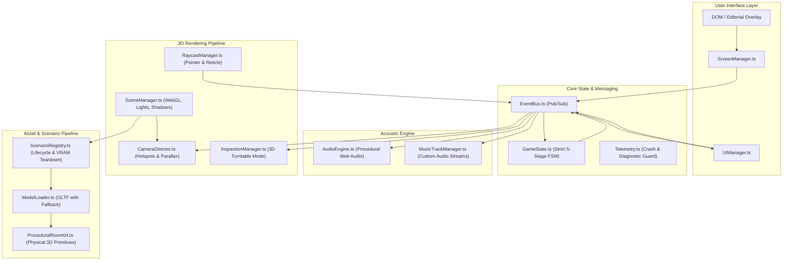

# THE VAULT: MASTER DOCUMENTATION

*This document is an automated compilation of all technical, architectural, and design documentation for The Vault project.*

---

# The Vault: Room 04

An uncanny psychological thriller 3D simulation built with Three.js, Vite, and TypeScript.
Aesthetic direction: Bauhaus Modernist Psychological Horror (*A Cure for Wellness*, *Severance*, David Lynch).

For comprehensive technical onboarding, architecture breakdown, and MCP guide, see:
**[docs/ONBOARDING.md](docs/ONBOARDING.md)**

For strict UI guidelines, Editorial constraints, and aesthetic standards, see:
**[DESIGN_SYSTEM.md](DESIGN_SYSTEM.md)**

---

## Quickstart

### 1. Launch via Windows Batch Launcher
Double click `start.bat` to launch the local Vite development server and open the browser.

### 2. Manual Commands
```powershell
# Install dependencies (if needed)
npm install

# Typecheck source code
npm run typecheck

# Production build bundle
npm run build

# Run 3D and audio stress test suite
npm test

# Run all test suites
npm run test:all

# Start live development server
npm run dev
```

---

## Automated Verification Suites

```powershell
# 1. 3D Bounds, Audio Burst Limiting, VRAM Leak Check, Aspect Ratio & Visibility
node tests/test_3d_and_audio_stress.js

# 2. Room 04 360 Enclosure, Persistent Header HUD & Audio Startup State Audit
node tests/test_room04_audit_and_360.js

# 3. Capture and verify visual 3D screenshots (WebGL Angle)
node tests/verify_room04_visuals.js

# 4. Audit modal overlays, close X buttons, 3D key turntable, and click/drag thresholds
node tests/test_interactions_and_overlays.js

# 5. Test full 8-Act narrative descent from Hub to Velvet Lounge
node tests/test_full_descent_e2e.js

# 6. Verify 0 VRAM memory leaks during infinite rapid scene transitions
npm run test:memory

# 7. Spam-click event lock validation and camera transition state integrity
npm run test:click
```

---


---

# The Vault: Room 04 - Technical Onboarding & Architecture Guide


## 1. Project Overview & Aesthetic Identity

"The Vault: Room 04" is an interactive 3D psychological thriller web application built with Three.js, Vite, and TypeScript.
The narrative and visual design follow a strict Bauhaus Modernist Psychological Horror aesthetic inspired by David Lynch (*Mulholland Drive*), Gore Verbinski (*A Cure for Wellness*), and *Severance*.

- **Setting:** Sanatorium of Cognitive Alignment, Sub-Level 04.
- **Protagonist:** Subject 104.
- **Visual Principles:**
  - Glazed sage-green ceramic subway tiles with bevel highlights and recessed grout bump maps.
  - Fine pale terrazzo floor with marble aggregate chips and symmetrical brass dividers.
  - Marcel Breuer tubular chrome and smoked teak Bauhaus furniture.
  - Titanium and chalk instrumentation with phosphor green CRT oscilloscope displays.
  - High-contrast clinical shadows via directional key and focused surgical spotlights.
  - Dark glassmorphic HUD overlays with hairline reticles, Outfit sans-serif typography, and zero generic modern UI tropes.

---

## 2. System Architecture & Modular Decoupling

The project avoids monolithic god-objects by enforcing decoupled boundaries mediated by a typed Publish/Subscribe EventBus:

```
src/
├── main.ts                    # Application bootstrap, lifecycle loop, and resize handlers
├── types/
│   └── index.ts               # Core TypeScript interfaces, GameStage enum, event payloads
├── core/
│   ├── EventBus.ts            # Decoupled singleton pub/sub mediator
│   ├── GameState.ts           # Central Finite State Machine (FSM) & puzzle stages
│   └── Telemetry.ts           # Diagnostic logging, crash resilience & WebGL recovery
├── audio/
│   ├── AudioEngine.ts         # Procedural Web Audio API synthesizer & cassette logs
│   └── MusicTrackManager.ts   # Custom track audio loader with smooth crossfading
├── rendering/
│   ├── SceneManager.ts        # Three.js renderer, ACESFilmic tone mapping, PCF shadows
│   └── CameraDirector.ts      # OrbitControls & cinematic camera transitions with input locks
├── entities/
│   ├── ProceduralTextures.ts  # Canvas-generated ceramic tiles, terrazzo, CRT screen maps
│   ├── ProceduralRoom04.ts    # Procedural 3D geometry fallback for Room 04 (The Central Hub)
│   ├── HubDecayManager.ts     # Progressive material rot, bruising, and weeping in Room 04
│   └── CRTNodePatcher.ts      # 2D Canvas phosphor node-linking minigame
├── scenarios/
│   ├── ScenarioRegistry.ts    # Chamber loader with recursive GPU VRAM disposal
│   ├── Room04_SterileChamber.ts # Act I Hub chamber logic
│   ├── Room02_SleepWard.ts    # Act II Sleep Ward & 3-digit rotary lock (1-0-4)
│   ├── Room03_Hydrotherapy.ts # Act III Hydrotherapy chamber & valve manifold puzzle
│   ├── Room04_AudiologyVault.ts # Act IV Audiology chamber & 741 Hz amplifier slider
│   ├── Room05_Archive.ts      # Act V Archive maze & patient filing drawer 104
│   ├── Room06_DirectorsOffice.ts # Act VI Void office & breathing telephone
│   └── Room08_VelvetLounge.ts # Act VIII Lynchian climax with sole ringing payphone
├── interaction/
│   ├── RaycastManager.ts      # Cursor hover reticle & drag-vs-click separation (<6px / <500ms)
│   ├── InspectionManager.ts   # Isolated WebGL 3D turntable for inspecting items (Brass Key)
│   └── DevTransformGizmo.ts   # In-Engine 3D transform tool for Dev Mode
├── editor/
│   ├── Dev3DEditorPanel.ts    # React-like DOM Dev tool for multi-select and live persistence
│   ├── EditorServerSync.ts    # Local API hooks to auto-save layout.json
│   ├── EditorVisualizers.ts   # Raycast hover bounding box visualizers
│   └── EditorPrefabs.ts       # Spawners for clocks, lights, and set dressing
│   └── InspectionManager.ts   # Isolated WebGL 3D turntable for inspecting items (Brass Key)
└── ui/
    ├── ScreenManager.ts       # View state router (title, chamber, dossier, inspect, debrief)
    └── UIManager.ts           # Chapter cards, sensory subtitles, and modal controls
```

### Core Communication Contracts
- **`EventBus.ts`:** All inter-module events are strictly typed (`game:stage_transition`, `camera:move_to_hotspot`, `puzzle:crystal_collected`, `puzzle:crt_patch_completed`, `ui:view_changed`, `ui:subtitle_changed`).
- **`GameState.ts`:** Strict linear stage machine tracking progression from `ACT_1_HUB_AWAKEN` through `ACT_8_SUBWAY_CLIMAX`.
- **`ScenarioRegistry.ts`:** Loads individual room scenario classes, swaps active scene graphs, and executes `disposeHierarchy()` on unmounted meshes and textures to prevent WebGL memory leaks. Automatically triggers `AudioEngine.getInstance().teardownScenarioAudio()` on room unmount.
- **`AudioEngine.ts` Audio Cascading & Limiter Safeguards:**
  - Hardware Master Limiter: `DynamicsCompressorNode` (`threshold: -14dB`, `knee: 24`, `ratio: 10`, `attack: 0.003s`, `release: 0.20s`) inserted before `destination` to prevent digital clipping when voices sum.
  - Active Sweep Oscillator Cancellation: `playToneAlignmentSweep` ramps down and disconnects previous sweeps before scheduling new frequencies, eliminating voice stacking explosions during rapid slider/dial manipulation.
  - Node Lifecycle Cleanup: One-shot nodes (`playTumblerClick`, `playPneumaticHiss`, `playWaterDrip`, `playHandsetClick`) attach `onended` callbacks to immediately disconnect gain nodes upon completion.

---

## 3. The 8-Act Hub-and-Spoke Narrative Progression

1. **Act I: The Central Hub (The Reception)**
   - Wakes in Room 04. Unseals Crimson Dossier on desk.
   - Calibrates rotary dial to 528 Hz. Primary relay thrown. Forward corridor door unseals.
2. **Act II: Room 02 - The Sleep Ward**
   - Investigates Subject 101-103 clipboards.
   - Solves 3-digit rotary lock (1-0-4) on dispensary trolley to recover Quartz Crystal.
   - Returns to Hub, patches CRT Node 1, listens to Audio Log 1 ("A cure for human sorrow").
3. **Act III: Room 03 - The Hydrotherapy Chamber**
   - Balances 3 brass valves on manifold to reduce pressure to 0 PSI. Recovers Bronze Crystal.
   - Returns to Hub (Decay Level 2), patches CRT Node 2, listens to Audio Log 2 ("Flesh is the infection").
4. **Act IV: Room 04 - The Audiology Vault**
   - Tunes amplifier frequency slider to 741 Hz to match resonant harmonic. Recovers Amethyst Crystal.
   - Returns to Hub (Decay Level 3), patches CRT Node 3, listens to Audio Log 3 ("Death is absolute alignment").
5. **Act V: Room 05 - The Archive**
   - Searches spiral cabinet maze for drawer 104. Recovers Obsidian Crystal.
   - Returns to severely bruised Hub (Decay Level 4), patches CRT Node 4, listens to Audio Log 4 ("The carrier is ready").
6. **Act VI: Room 06 - The Director's Office**
   - Crosses pitch-black void to spotlighted mahogany desk. Answers telephone with wet breathing. Recovers Celadon Crystal.
7. **Act VII: The Central Hub - Synthesis & Blackout**
   - Final harmonic lock triggers total electrical blackout and 3-second acoustic void.
   - Exit blastdoor blows open with concussive air hiss and warm amber spill.
8. **Act VIII: The Velvet Lounge (The Deployment)**
   - Steps through blastdoor into Lynchian red velvet lounge.
   - All environment interaction disabled except the solitary ringing payphone.
   - Answering the receiver plays player voice: *"The exit is open. The cure is spreading. Thank you for your compliance."*
   - Concussive 528 Hz sonic blast; permanent cut to black.

---

## 4. Runbook: Execution & Testing Commands

### Windows One-Click Launchers
- `start.bat`: Starts local Vite development server and opens default browser.
`: Runs automated end-to-end verification and diagnostic checks.

### Terminal Commands (PowerShell / Command Prompt)
```powershell
# Typecheck TypeScript source
npm run typecheck

# Production build bundle
npm run build

# Run 3D and Audio Stress Test Suite (TypeScript check + Playwright stress suite)
npm test

# Run all test suites sequentially
npm run test:all

# Start local preview server
npm run preview

# Start development live reload
npm run dev
```

### Automated Playwright Test Suites
Run these scripts using Node.js to verify functionality:
```powershell
# 1. 3D Bounds, Audio Burst Limiting, VRAM Leak Check, Aspect Ratio & Visibility
node test_3d_and_audio_stress.js

# 2. Room 04 360 Enclosure, Persistent Header HUD & Audio Startup State Audit
node test_room04_audit_and_360.js

# 3. Visual Verification & Screenshots (WebGL Angle)
node verify_room04_visuals.js

# 4. Modal Overlays, Close X, 3D Key Turntable & Click-vs-Drag Audit
node test_interactions_and_overlays.js

# 5. Full 8-Act Hub-and-Spoke Narrative Descent E2E
node test_full_descent_e2e.js

# 6. Verify 0 VRAM memory leaks during infinite rapid scene transitions
npm run test:memory

# 7. Spam-click event lock validation and camera transition state integrity
npm run test:click
```

---


## 6. Developer Mode & Prefab System

The Vault features a built-in 3D level editor to manipulate the environment during development:
1. **Accessing the Editor:** Append ?editor=true to the URL or press the [DEV MODE] button in the HUD to open the editor panel.
2. **Transform Controls:** Click any prop to attach the 3D gizmo. Use W (Move), E (Rotate), and R (Scale) to adjust objects. Press Ctrl+Z to undo mistakes.
3. **Multi-Select:** Hold Shift and drag a marquee box to select and move multiple objects synchronously.
4. **Prefabs:** Use the "Spawn Prefab" dropdown to insert modular furniture (Desks, Chairs) or general prefabs (Paintings, Plants). For Paintings, you can import custom textures via URL.
5. **Sandbox Mode:** Jump to the "Empty Sandbox Scene" via the Scenarios tab to prototype custom environments from scratch.
6. **Live Persistence:** Clicking "Save to Server" pushes coordinates directly to src/data/room_layout.json via a Vite dev server plugin, bypassing HMR for seamless live-editing.


---

# The Vault - Design System

This document outlines the visual identity and UI component library for "The Vault: Room 04", ensuring consistency across all screens, menus, and overlays.

## 1. Aesthetic Concept
**Analogue Clinical Brutalism.** The UI should feel like printed dossier files from a 1960s/1970s bureaucratic institution or a scientific sanatorium. It relies heavily on stark black-and-white contrasts, strict typographic hierarchy, and minimal ornamentation. There is absolutely zero use of generic modern Dribbble aesthetics (no purple gradients, no glowing orbs, no rounded glassmorphism). Emojis are strictly prohibited.

## 2. Color Palette
- **Ink Black** (ar(--ink-black, #030403)): Primary text color, heavy borders, button hover states.
- **Dossier Paper** (ar(--dossier-paper, #ebefeb)): Primary background color for modals, menus, and the main menu screen.
- **Sterile White** (#ffffff): Highlights and flash transitions.
- **Muted Ink** (
gba(0, 0, 0, 0.4)): Subtitles, inactive states, thin dividers.
- **CRT Phosphor** (#4adb85): Used *only* sparingly for legacy terminal interactions.

## 3. Typography
- **Primary Sans-Serif:** Arial, Helvetica, sans-serif. Used for body copy and main titles. Clean, unopinionated, bureaucratic.
- **Monospace:** Courier New, Courier, monospace. Used for metadata, subtitles, labels, and system readouts.
  - *Rule:* Monospace text should always be uppercase with wide tracking (letter-spacing: 0.15em to .2em).

## 4. Components

### Pill Buttons (\.pill-btn\)
- **Shape:** Fully rounded (order-radius: 40px).
- **Style:** Transparent background, 1px solid var(--ink-black) border, black text.
- **Hover State:** Inverts to solid black background with white text.
- **Usage:** Primary actions (Start, Settings, Return, Take Item).

### Dossier Panels (\.dossier-paper\)
- **Shape:** Sharp corners or very slight rounding (order-radius: 4px).
- **Style:** Solid off-white background, subtle drop shadow (ox-shadow: 0 8px 32px rgba(0,0,0,0.15)), thin internal borders.
- **Usage:** Settings menu, Inventory, reading materials.

### Typography Hierarchy
- **Title (\.dossier-title\):** Large Sans-serif, bold, tight tracking.
- **Subtitle (\.dossier-subtitle\):** Small Monospace, uppercase, wide tracking, muted color.
- **Body:** Standard Sans-serif, 14px, 1.5 line height, black.


---

# Technical Architecture Specification: The Vault (Room 04)

## 1. Architecture Overview & Principles
* **Framework & Tooling:** Vite + TypeScript (`strict: true`), Three.js (`@types/three`), TWEEN.js.
* **Core Architectural Principle:** **Strict Decoupling via Event Mediator.** Zero God objects. The rendering loop, audio engine, state machine, camera director, and UI communicate strictly through a typed publish/subscribe `EventBus`.
* **Single WebGL Context:** A single WebGL renderer manages the room scene and 3D object examination mode via scene swapping or layered render passes, preventing WebGL context-limit crashes.
* **Hybrid Asset Pipeline:** Supports loading external `.glb` modular props from Blender (`/assets/models/`) with an automatic, instant fallback to procedural 3D geometry (`ProceduralRoom04.ts`).

---

## 2. System Dependency Diagram



---

## 3. Subsystem Breakdown

### 3.1. Core Messaging (`core/EventBus.ts`)
* Lightweight, strongly typed event mediator.
* Prevents cyclic dependencies and direct module coupling.
* Standardized event taxonomy:
  * `INPUT:OBJECT_CLICKED`: `{ objectId: string; hitPoint: THREE.Vector3 }`
  * `INPUT:OBJECT_HOVERED`: `{ objectId: string | null; label: string }`
  * `GAME:STAGE_TRANSITION`: `{ fromStage: GameStage; toStage: GameStage }`
  * `PUZZLE:ITEM_COLLECTED`: `{ itemId: string }`
  * `PUZZLE:KEY_ALIGNED`: `{ pinExtended: boolean }`
  * `PUZZLE:KEY_INSERTED`: `{}`
  * `PUZZLE:FREQUENCY_CHANGED`: `{ frequency: number; isResonating: boolean }`
  * `PUZZLE:SWITCH_THROWN`: `{}`
  * `CAMERA:MOVE_TO_HOTSPOT`: `{ hotspotId: string }`
  * `INSPECT:OPEN`: `{ targetMesh: THREE.Object3D }`
  * `INSPECT:CLOSE`: `{}`
  * `AUDIO:TRIGGER_FX`: `{ effectId: string }`

### 3.2. Finite State Machine (`core/GameState.ts`)
* Enforces a deterministic, linear progression:
  * `STAGE_0_INIT`: Room sealed, dossier uninspected.
  * `STAGE_1_DOSSIER_UNSEALED`: Crimson envelope opened; frequency clue (528 Hz) revealed.
  * `STAGE_2_BELL_LIFTED`: Bell jar elevated; Brass Key collected into inventory.
  * `STAGE_3_KEY_EXAMINED_AND_ALIGNED`: Key pins deployed via 3D examination mode.
  * `STAGE_4_CONSOLE_REVEALED`: Key inserted; vault faceplate slides open.
  * `STAGE_5_FREQUENCY_LOCKED`: Oscilloscope tuned to 528 Hz; resonance solenoid clicks.
  * `STAGE_6_DEPRESSURIZED_AND_UNLOCKED`: Knife switch thrown; steam hisses; specimen revealed; exit door LED turns green.
* Invalid clicks (e.g., throwing the switch before frequency alignment) are rejected with descriptive context subtitles.

### 3.3. Hybrid Asset Pipeline (`loaders/ModelLoader.ts`)
* Standard load method: `modelLoader.loadProp(propName: string, fallbackBuilder: () => THREE.Group): Promise<THREE.Group>`
* Checks for external GLTF/GLB files in `/assets/models/${propName}.glb`.
* If found: parses scene graph, validates mesh nodes, attaches shadow flags, and returns the group.
* If absent (or if fetch fails due to `file://` CORS restrictions): immediately executes `fallbackBuilder()`, instantiating the procedural 3D primitives from `ProceduralRoom04.ts`.
* Guarantees zero downtime while providing full Blender asset drop compatibility.

### 3.4. PC Camera Ergonomics (`rendering/CameraDirector.ts`)
* **Ambient Mouse Parallax:** Computes mouse offset from screen center; applies a subtle lerped offset ($\pm 0.15$ units) to camera position during idle states.
* **Hotspot Focus Navigation:** Pre-calculated camera positions and look-at targets for:
  * `overview`: Isometric room view.
  * `vault`: Close-up of central titanium apparatus.
  * `telephone`: Close-up of vintage rotary phone.
  * `envelope`: Top-down view of the teak desk and crimson dossier.
  * `door`: View of the sealed blank firedoor.
* **Clamped Hotspot Orbiting:** When focused on a hotspot, OrbitControls is enabled with clamped polar ($15^\circ$ to $65^\circ$) and azimuth angles ($\pm 45^\circ$) to allow examining the object without disorientation.
* **Transition Gating (`isTransitioning`):** Disables raycasting and parallax while camera is tweening to prevent orientation collisions.

### 3.5. 3D Inspection Mode (`interaction/InspectionManager.ts`)
* Uses a secondary Three.js scene (`inspectScene`) rendered to the primary viewport.
* When active, the Brass Key is centered and isolated.
* Player drags with mouse to rotate 360° around any axis.
* Raycasting within the inspection scene detects clicks on the keypin sliding notch, triggering the pin extension animation and dispatching `PUZZLE:KEY_ALIGNED`.
* Exiting returns camera authority cleanly to `CameraDirector`.

### 3.6. VRAM Management & Disposal (`scenarios/ScenarioRegistry.ts`)
* Handles scenario switching without memory leaks.
* Recursively traverses meshes on unmount:
  ```typescript
  export function disposeHierarchy(object: THREE.Object3D): void {
    object.traverse((child) => {
      if (child instanceof THREE.Mesh) {
        if (child.geometry) child.geometry.dispose();
        if (child.material) {
          if (Array.isArray(child.material)) {
            child.material.forEach(disposeMaterial);
          } else {
            disposeMaterial(child.material);
          }
        }
      }
    });
  }
  ```

### 3.7. Audio Architecture (`audio/AudioEngine.ts` & `MusicTrackManager.ts`)
* **Web Audio Autoplay Guard:** `AudioContext` is suspended on initialization and resumed via an explicit pointer listener on the intro screen.
* **Procedural Synthesis:** Synthesizes low 45Hz drone with binaural beating, 60Hz/120Hz ballast buzz, tumbler clicks, 400–700Hz sine sweep, filtered white noise hiss, and clinical two-tone chime.
* **Custom Audio Streams:** `MusicTrackManager` streams external audio files (`/assets/audio/music/`) with automatic volume ramping and crossfading.

### 3.8. Telemetry & Crash Recovery (`core/Telemetry.ts`)
* Global error listener capturing uncaught exceptions, promise rejections, and WebGL context loss.
* Stores diagnostics in a circular memory buffer (100 entries).
* Emits visual recovery indicators in the UI without halting gameplay.

### 3.9. Developer Mode & Transform Gizmo (editor/ & ui/Dev3DEditorPanel.ts)
* Provides a full in-engine level editor built on TransformControls and SelectionBox.
* Features multi-select marquee drag, Ctrl+Z transform undo history, and gizmo mode switching (Translate/Rotate/Scale).
* Features a Prefab Spawner to drop modular assets (furniture, lights, clocks) into any scenario.
* Integrates a Live Telemetry Dashboard displaying FPS, memory allocations, and triangle counts.
* Layout JSON (
oom_layout.json) is live-saved directly via a custom Vite server plugin intercepting API POST calls, bypassing HMR for live updates.


---

# Master Narrative Bible: The Descent of Subject 104

## 1. Structural Paradigm: The Hub-and-Spoke Descent

```
[THE HUB: THE SURFACE] (Room 04: Sterile Reception & CRT Terminal)
         │
         ├───► [ACT II: THE SLEEP WARD] (First Descent ──► Crystal 1: Quartz)
         │           │
         │           └───► Return to Hub: Patch CRT Node 1 (Audio Log 1)
         │
         ├───► [ACT III: THE HYDROTHERAPY ROOM] (Second Descent ──► Crystal 2: Drained Brass)
         │           │
         │           └───► Return to Hub: Patch CRT Node 2 (Audio Log 2)
         │
         ├───► [ACT IV: THE AUDIOLOGY VAULT] (Reality Fracture ──► Crystal 3: Amplifier Cone)
         │           │
         │           └───► Return to Hub: Patch CRT Node 3 (Audio Log 3)
         │
         ├───► [ACT V: THE ARCHIVE] (Deep Sickness ──► Crystal 4: Pitch-Black Jagged)
         │           │
         │           └───► Return to Hub: The Hub Decays (Audio Log 4)
         │
         └───► [ACT VI: THE DIRECTOR'S OFFICE] (The Core ──► Crystal 5: The Glowing Heart)
                     │
                     └───► [ACT VII: THE SYNTHESIS] (All 5 Crystals Patched ──► Hub Blackout)
                                 │
                                 └───► [ACT VIII: THE ESCAPE / DEPLOYMENT] (The 1950s Subway)
```

The game is structured as a **Hub-and-Spoke Psychological Descent**. The player does not move continuously forward through a linear hallway; they must repeatedly return to **The Central Hub (Room 04)** to insert the recovered Memory Crystals into the CRT Oscilloscope Terminal. 

With every return to the Hub, two things degrade:
1. **The CRT Node Interface:** Connecting the visual signal nodes becomes more corrupted, static-filled, and erratic.
2. **The Hub Itself:** The pristine, symmetrical alabaster walls and glazed green tiles begin to bruise, crack, and discolour, reflecting the irreversible psychological infection taking hold of Subject 104.

---

## 2. Full Chamber Breakdown & Narrative Progression

### Act I: The Hub (The Surface)
* **Visual Atmosphere:** Blinding white screen that slowly blurs into sharp focus. Symmetrical, immaculate, clinical room. Smoked teak desk in center with the Crimson Dossier, the vintage cream telephone, and the titanium CRT Oscilloscope. To the far left sits a heavy, locked steel Exit door.
* **The Interaction:** The player inspects the Crimson Dossier, learning their designation is "Subject 104." They tune the frequency dial on the bedside CRT to 528 Hz.
* **The Audio:** A warm, calm, mid-century corporate voice plays through the speaker:
  > *"Subject 104. Consciousness recovery confirmed. Baseline equilibrium achieved. Proceed to the forward observation corridor."*
* **The Threshold:** A heavy mechanical thunk echoes through the floor wainscoting. The steel blast door directly ahead unseals and swings open into the dark corridor.

---

### Act II: Room 2 — The Sleep Ward (The First Descent)
* **Visual Atmosphere:** A long, sterile observation dormitory maintaining the clean illusion of safety. Two rows of olive-drab military cots are bolted to the polished terrazzo floor in razor-sharp alignment.
* **Exploration:** Clipboards hang from the foot of each cot. The notes are typed with bureaucratic coldness, recording the sleep cycles, REM intervals, and "harmonic alignment progress" of Subjects 101, 102, and 103.
  * *Subject 101 Notes:* "Tremors ceased on Day 4. Subject no longer recognizes mirror reflection. Progress satisfactory."
  * *Subject 102 Notes:* "Vocal chords surgically desensitized to eliminate nocturnal screaming. Sleep cycle stabilized."
* **The Artifact:** On a stainless steel surgical tray at the far end rests **Memory Crystal 01 (Prismatic Quartz)**.
* **Return to Hub (The First Patch):** The player returns to Room 04 and slots Crystal 01 into the CRT receptacle. The CRT switches to a node-patching interface where the player connects two clean green sine wave vectors across the grid.
* **Audio Log 01 (Crisp Cassette Tape):**
  > *"Recording Date: August 14, 1973. Subject 104 is responding well to phase decoupling. The limbic friction has abated. The cure for human sorrow is within reach."*

---

### Act III: Room 3 — The Hydrotherapy Room (The Second Descent)
* **Visual Atmosphere:** Grounded in institutional architecture, but lighting becomes noticeably harsher, casting deep, knife-like shadows across hexagonal pale turquoise tiles. The room is filled with deep porcelain immersion tubs and heavy overhead steel winches.
* **Exploration:** The pipes and chrome taps are bone dry, yet the dynamic subtitle notes: *"A faint, coppery smell hangs in the vapor. A distinct dripping echoes through the room, though no water flows."*
* **The Artifact:** Inside a drained, cast-iron floor drainpipe lies **Memory Crystal 02 (Oxidized Bronze / Amber Tint)**.
* **Return to Hub (The Second Patch):** The CRT node interface is more erratic; signal lines flicker and drift. The player manually adjusts frequency damping to bridge the fractured trace.
* **Audio Log 02 (Analog Tape Degradation with Hiss):**
  > *"Observation 44. Dr. Vandermeer recording. The hydrotherapy immersion protocols have failed because we continue to treat the symptom. Sorrow is not an infection. Flesh is the infection."*

---

### Act IV: Room 4 — The Audiology Vault (The Reality Fracture)
* **Visual Atmosphere:** The threshold where Lynchian surrealism directly fractures the physical architecture. The geometry of the room is slightly wrong: angles are not 90 degrees; walls seem to converge upward. Pristine black-and-white Bauhaus geometric paintings on the walls have warped—the straight lines are smeared into heavy, vibrating, impressionistic charcoal strokes.
* **Exploration:** A towering monolith of stacked 1960s tube amplifiers and tangled, snaking black cables occupies the far corner, emitting an audible low-frequency hum.
* **The Artifact:** **Memory Crystal 03 (Amethyst / Fractured Core)** is lodged directly inside the torn paper cone of a massive 15-inch speaker cabinet.
* **Return to Hub (The Third Patch):** The CRT terminal actively resists the player: nodes jitter and drift across the phosphor grid with loud analog static pops.
* **Audio Log 03 (Pitch-Shifted Voice with Vinyl Surface Crackle):**
  > *"Life is the disease. Death is the absolute alignment. We must synthesize the silence."*

---

### Act V: Room 5 — The Archive (The Deep Sickness)
* **Visual Atmosphere:** Openly hostile and physically repulsive. Towering olive-drab steel filing cabinets are arranged in a suffocating, impossible spiral maze that defies exterior room dimensions. The overhead illumination is a sickly, chemical fluorescent green.
* **Exploration:** The floor is submerged under thousands of tangled, severed black rotary telephone cords that coil and twitch across the tiles like organic root structures.
* **The Artifact:** In the center of the spiraling cabinets rests **Memory Crystal 04 (Pitch-Black, Jagged Obsidian)**.
* **Return to Hub (The Sickness Spreads):** The player ascends back to the Central Hub, but the Hub is now visually diseased. The once-pristine alabaster walls are stained with dark, bruised contusions; the glazed green tiles are weeping dark fluid along the grout seams.
* **Audio Log 04 (Terrifyingly Calm Automated Synth Voice):**
  > *"The ultimate silence is prepared. The carrier is ready."*

---

### Act VI: Room 6 — The Director's Office (The Core)
* **Visual Atmosphere:** The deepest level. Total sensory deprivation: pitch-black darkness extending infinitely in all directions, except for a single, surgical spotlight cutting down onto a massive, heavy mahogany desk.
* **Exploration:** No medical tools, no clipboards, no filing cabinets. Only two items rest on the wood grain:
  1. A single, cream rotary telephone with no wall cord.
  2. **Memory Crystal 05 (The Glowing Celadon Core)**.
* **The Interaction:** Clicking the telephone receiver produces no dial tone. Instead, through the earpiece comes the distinct, close sound of **faint, wet breathing** directly into the receiver microphone.
* **The Recovery:** The player collects Crystal 05 and turns back to make their final ascent to the Hub.

---

### Act VII: The Hub (The Synthesis & Total Blackout)
* **The Final Patch:** The player inserts Crystal 05 into the decaying CRT terminal.
* **The Puzzle:** A complex, multi-channel vector alignment puzzle where all five frequency waveforms must be phase-locked simultaneously into a single flatline harmonic bar.
* **The Blackout:** Upon achieving harmonic lock:
  * The CRT screen emits a high-pitched electrical whistle and abruptly snaps off.
  * Every ceiling spotlight cuts out simultaneously, plunging the chamber into complete, breathless pitch black.
  * Three seconds of absolute silence.
  * A deafening pneumatic release clangs through the structure as the **heavy Exit Door on the far left**—the door sealed since the opening moments of the game—unlocks with a concussive gasp of pressurized air and slowly creaks open into blinding light.

---

### Act VIII: The Escape / The Deployment (The 1950s Subway Climax)
* **The Illusion of Freedom:** The player steps through the exit door, expecting to emerge into the fresh air of the Baltic coastline. Instead, they find themselves standing inside a blindingly bright, pristine 1950s subway passenger car.
* **The Auditory Facade:** Warm, smooth mid-century jazz plays softly over the overhead train intercom. The train rattles steadily along invisible tracks.
* **The Art-Noir Plague:** As the player points and clicks to advance down the central aisle, reality decays in real-time:
  * The vibrant mustard and teal colors of the seats bleed out, turning to dead charcoal and ash gray.
  * The warm jazz music stretches, pitch-shifts down two octaves, and warps into a sickening, churning low-frequency drone.
  * Clicking on the darkened glass window of the subway door reveals the player's reflection: it is not a human face, but a **pitch-black, featureless silhouette**.
* **The Final Telephone:** At the far bulkhead of the subway car, an analog wall-mounted payphone begins to ring with a deafening, piercing analog bell clatter.

---

## 3. Analysis of the Final Climax Interaction: The Subway Payphone

### Question: What kind of interaction should the final payphone require? Should picking it up be the only clickable option left on the screen, forcing the player to trigger the end themselves?

### The Narrative & Psychological Answer:
**Yes. It must be the ONLY clickable interaction on screen, transforming the player from an observer into the deliberate executor of their own doom.**

#### Why This Is Essential for the Lynchian Psychological Horror:
1. **The Elimination of Choice as Thematic Truth:**  
   Throughout the entire game, the Directorate's core doctrine has been *"Compliance is Equilibrium."* If the game offered an alternate button (e.g. `[TRY TO FORCE SUBWAY DOOR]` or `[TURN BACK]`), it would grant the player the illusion of agency. By removing all other interactive hotspots, the game environment itself enforces total clinical compliance. There is literally nowhere else to click. The train is moving; the windows are black voids; the doors behind them are sealed.

2. **The Acoustic Escalation:**  
   * The ringing bell must be physically overwhelming in the mix (an authentic 1950s dual-gong mechanical bell at 850 Hz / 1050 Hz), ringing every 2.5 seconds with heavy stereo resonance.
   * With each ring, the camera subtly dollies closer to the hanging chrome handset, heightening claustrophobia.
   * The reticle prompt changes from `[EXAMINE]` to simply:  
     `[ANSWER]` (or `[RECEIVE]`).

3. **The Execution Sequence (Step-by-Step):**
   * **Step 1 (The Forced Click):** The player is forced to click the ringing payphone receiver to make the noise stop.
   * **Step 2 (The Acoustic Shock):** The moment they click, the deafening bell cuts out instantly. Total acoustic vacuum. Dead room silence for 1.5 seconds.
   * **Step 3 (Handset Lift):** The mechanical sound of the handset lifting off the hook plays close to the ear.
   * **Step 4 (The Voice):** A deadened, completely flat version of **their own voice** speaks through the receiver:
     > *"The exit is open. The cure is spreading. Thank you for your compliance."*
   * **Step 5 (The 528 Hz Concussion):** Immediately on the word *"compliance,"* an ear-splitting, sustained 528 Hz pure sine wave hits at full dynamic range.
   * **Step 6 (Cut to Black):** The visual cuts instantly to pure black. The 528 Hz frequency drone holds for 4 seconds, then terminates abruptly into total silence.

#### The Narrative Revelation:
The player was never escaping. Room 04 was not a prison; it was an intake preparation chamber. Subject 104 was not breaking out of the Sanatorium; they were being **conditioned, calibrated, and deployed as Patient Zero** carrying the "cure for human sorrow" (the psychological plague of total numbness and compliance) directly into the populated civilian subway network. The player did not win—they completed their own calibration.

