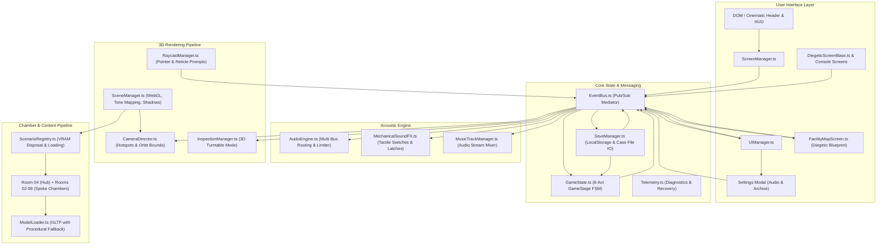

# THE VAULT: MASTER DOCUMENTATION

*This document is an automated compilation of all technical, architectural, and design documentation for The Vault project.*

---

# The Vault: Sub-Level 04

An interactive 3D psychological thriller web application built with Three.js, Vite, and TypeScript.
Aesthetic direction: Bauhaus Modernist Psychological Horror (*A Cure for Wellness*, *Severance*, David Lynch).

For technical onboarding, architecture breakdowns, and scenario guidelines:
- Technical Onboarding: [docs/ONBOARDING.md](docs/ONBOARDING.md)
- System Architecture: [docs/ARCHITECTURE.md](docs/ARCHITECTURE.md)
- Design System & Aesthetic Tokens: [DESIGN_SYSTEM.md](DESIGN_SYSTEM.md)
- Narrative Lore & Puzzle Bible: [docs/DIEGETIC_PUZZLE_BIBLE.md](docs/DIEGETIC_PUZZLE_BIBLE.md)

---

## Chambers & Narrative Progression

The facility comprises 8 connected sectors centered around the Central Hub (Room 04):

1. **Act I: The Reception (Room 04 - Sterile Chamber)**: Central Hub awakening, rotary telephone intake, brass shunt calibration, Tektronix 545B CRT harmonic lock, blastdoor breach.
2. **Act II: The Sleep Ward (Room 02 - Sleep Ward)**: Dormitory isolation, 2-step sequential dispensary machine: Step 1 mechanical shutter (intake code 1-0-4 from clinical charts) unlocking Step 2 internal infusion console (68 BPM peristaltic drip sync + ultraviolet chemical triad [Nitrous - Bromide - Valerian]), unoccluded Cot 104 UV markings (Recovery of Memory Crystal 01: Quartz).
3. **Act III: Hydrotherapy (Room 03 - Hydrotherapy Suite)**: Siphon manifold hydrostatic pressure balance (volume invariant = 6 units), submerged drain hatch unseal (Recovery of Memory Crystal 02: Bronze).
4. **Act IV: The Audiology Vault (Room 04 - Audiology Vault)**: Acoustic null alignment via dual flared directional horns (45 deg / 135 deg azimuth), 741 Hz carrier frequency lock, 180 deg phase cancellation, Chladni plate nodal mandala stabilization (Recovery of Memory Crystal 03: Amethyst).
5. **Act V: The Archive (Room 05 - Archive)**: Microfiche optical viewer, spool alignment, focus correction, Sector Gamma-07 pneumatic dispatch tube canister routing (Recovery of Memory Crystal 04: Obsidian).
6. **Act VI: The Director's Office (Room 06 - Director's Office)**: Nagra SN wiretap tape decode at 0.5x speed, desk carriage clock escapement synchronization to 11:03, executive safe release (Recovery of Memory Crystal 05: Celadon).
7. **Act VII: Synthesis (Room 07 - Synthesis Chamber)**: Galvanometer resistance bridge balancing (100 Ohm equilibrium), 5-crystal cathode core harmonic alignment, facility blackout.
8. **Act VIII: The Velvet Lounge (Room 08 - Velvet Lounge)**: Lynchian chevron floor sanctuary, crystal decanter libation, 1950s telephone switchboard jack routing, compliance payphone finale.

---

## Diegetic Facility Blueprint

Sub-Level 04 includes an interactive architectural blueprint accessible via the **[FACILITY SCHEMATIC]** HUD button or direct in-world interaction with the blueprint board near the Hub blastdoor.
- **Top-Down Architectural Drafting**: 2D SVG floorplan rendered in mid-century clinical drafting style.
- **Fog of War Discovery**: Unvisited chambers are redacted with dark crosshatching and classified bars; visited chambers reveal room schematics, active beacons, and clearance status.
- **Custom Site Iconography**: Unique architectural line icons for each of the 8 sectors.
- **Alignment Progress Tracker**: Displays global facility synchronization status (e.g., 1 / 8 Sectors Synchronized) with status pips.
- **Non-Linear Navigation**: Enables instant bidirectional transit between the Central Hub and unlocked spoke chambers.

---

## Persistence & Audio Calibration Subsystems

- **Diegetic Save System (`SaveManager`)**: Automatic schema v1 persistence to `localStorage` key `the_vault_save_record` on progression milestones (stage transitions, crystal recovery, CRT node patching, inventory additions, and sector travel). Supports manual save, JSON case record export/import (`subject_104_case_record.json`), and atomic purge/reset to Act I baseline.
- **Multi-Bus Audio Routing (`AudioEngine`)**: Master brickwall limiter feeding independent `sfxGain` and `ambientGain` sub-busses. Provides dedicated level sliders with live percentage badges for Master Audio, Mechanical Apparatus SFX, and Ambient Room Tone, plus a continuous 45 Hz binaural drone toggle.
- **Optics & Immersion Controls**: Observation subtitles toggle, CRT scanline mesh overlay toggle, mouse parallax drift toggle, and camera re-alignment button.

---

## Quickstart

### 1. Windows Batch Launcher
Double-click `start.bat` to install dependencies (if needed), launch the Vite development server, and open the application in the default browser.

### 2. Manual Commands
```powershell
# Install dependencies
npm install

# Typecheck source code (strict: true)
npm run typecheck

# Production build bundle
npm run build

# Run unit tests (44 tests across 8 test suites)
npm run test:unit

# Run full fast test pipeline (Unit + Typecheck + Vite Build + 26 E2E suites in ~68s)
npm run test:fast

# Run smoke integration pipeline (Unit + Typecheck + Blueprint + Save + 3D Stress + 360 Audit)
npm run test

# Run legacy concurrent test matrix (44 unit tests + 26 concurrent Playwright E2E suites)
npm run test:all

# Recompile master documentation (Markdown & printable HTML)
npm run docs:build

# Start local development server
npm run dev
```

---

## Automated Test Harness

The testing suite features a dual-mode execution contract. All 26 test scripts under `tests/` export `runSuite(page, baseUrl)` for the unified, single-browser test runner (`tests/run_all_fast.js`), while retaining an independent execution guard (`isMain` checking `import.meta.url`) that launches an ephemeral static server (`server.listen(0)`) for standalone CLI debugging.

### Master Regression Runners
```powershell
# Unified Zero-Leak Full Suite (~68s, 1 Chromium process, isolated browser contexts)
npm run test:fast

# Smoke Test (Unit + 5 Core Integration Tests)
npm run test

# Unit Tests (44 Vitest assertions)
npm run test:unit
```

### Granular Scenario & Stress Suites
Individual test suites can be executed standalone in under 4 seconds without port collisions:

```powershell
# E2E Scenario Progression Suites
npm run test:pair1         # Acts I & II (Hub & Sleep Ward)
npm run test:pair2         # Acts III & IV (Hydrotherapy & Audiology)
npm run test:pair3         # Acts V & VI (Archive & Director's Office)
npm run test:pair4         # Acts VII & VIII (Synthesis & Velvet Lounge)

# Persistence & Settings Suite
npm run test:save          # SaveManager localStorage, auto-save reload & audio sliders

# Edge Case Validation Suites
npm run test:edge          # Act I edge cases & input limits
npm run test:phase2-edge   # Acts III & IV boundary conditions
npm run test:phase3-edge   # Acts V & VI boundary conditions
npm run test:phase4-edge   # Acts VII & VIII boundary conditions
npm run test:deep-edge     # Cross-chamber deep regression matrix

# Facility Blueprint & Navigation
npm run test:facility      # Blueprint modal lifecycle & CRT auto-patch
npm run test:blueprint     # Non-linear cross-spoke transit & state persistence

# Stress & Quality Audits
npm run test:memory        # VRAM disposal & WebGL leak validation
npm run test:click         # Rapid input & event queue stress
npm run test:perf          # Framerate & render budget benchmark
npm run test:ui            # Contrast, ARIA, and DOM accessibility
```


---

# The Vault: Sub-Level 04 - Technical Onboarding & Architecture Guide

## 1. Project Overview & Aesthetic Identity

"The Vault: Sub-Level 04" is an interactive 3D psychological thriller web application built with Three.js, Vite, and TypeScript.
The narrative and visual design follow a strict Bauhaus Modernist Psychological Horror aesthetic inspired by David Lynch (*Mulholland Drive*), Gore Verbinski (*A Cure for Wellness*), and *Severance*.

- **Setting:** Sanatorium of Cognitive Alignment, Sub-Level 04.
- **Protagonist:** Subject 104.
- **Visual Principles:**
  - Glazed sage-green ceramic subway tiles with bevel highlights and recessed grout bump maps.
  - Fine pale terrazzo floor with marble aggregate chips and symmetrical brass dividers.
  - Marcel Breuer tubular chrome and smoked teak Bauhaus furniture.
  - Titanium and chalk instrumentation with phosphor green CRT oscilloscope displays.
  - High-contrast clinical shadows via directional key and focused surgical spotlights.
  - Dark glassmorphic HUD overlays with hairline reticles, Outfit sans-serif typography, and zero generic modern UI tropes.

---

## 2. System Architecture & Modular Decoupling

The project avoids monolithic god-objects by enforcing decoupled boundaries mediated by a typed Publish/Subscribe EventBus. We enforce a Component-Scoped MVC architecture for our diegetic screens.

```
src/
├── main.ts                    # Application bootstrap, lifecycle loop, and resize handlers
├── types/
│   ├── index.ts               # Core TypeScript interfaces, GameStage enum, event payloads
│   └── cure.ts                # 8-Act narrative state slice interfaces
├── core/
│   ├── EventBus.ts            # Decoupled singleton pub/sub mediator
│   ├── GameState.ts           # Central Finite State Machine (FSM) & puzzle stages
│   ├── SaveManager.ts         # Persistent browser storage (schema v1), export/import & reset
│   ├── SaveManager.spec.ts    # Vitest unit tests for save serialization & hydration
│   └── Telemetry.ts           # Diagnostic logging, crash resilience & WebGL recovery
├── audio/
│   ├── AudioEngine.ts         # Multi-bus Web Audio synthesizer, sub-busses & brickwall limiter
│   ├── MechanicalSoundFX.ts   # Tactile click, latch, and switch SFX generator
│   └── MusicTrackManager.ts   # Custom track audio loader with smooth crossfading
├── rendering/
│   ├── SceneManager.ts        # Three.js renderer, ACESFilmic tone mapping, PCF shadows
│   ├── CameraDirector.ts      # OrbitControls & cinematic camera transitions with input locks
│   └── AnimatorSystem.ts      # Tween update pipeline for smooth prop animations
├── interaction/
│   ├── RaycastManager.ts      # Pointer raycasting, hierarchy traversal, dynamic reticle prompts
│   ├── InspectionManager.ts   # 3D key examination turntable mode with pin alignment
│   ├── DevTransformGizmo.ts   # Interactive 3D translation/rotation manipulation gizmo
│   └── InteractionPipelines.spec.ts # Vitest unit tests for raycast traversal & pin math
├── entities/
│   ├── ProceduralTextures.ts  # Canvas-generated ceramic tiles, terrazzo, CRT screen maps
│   ├── ProceduralRoom04.ts    # Procedural 3D geometry fallback for Room 04 (The Central Hub)
│   ├── HubDecayManager.ts     # Progressive material rot, weeping, and fungal decay in Room 04
│   ├── CRTNodePatcher.ts      # 2D Canvas phosphor node-linking puzzle for crystal integration
│   └── room04/                # Modular Hub sub-assemblies (Shell, Props, Apparatus, Furniture)
├── scenarios/
│   ├── ScenarioRegistry.ts    # Chamber loader with recursive GPU VRAM disposal
│   ├── ScenarioRegistry.spec.ts # Vitest unit tests for scenario lifecycle & mutex locks
│   ├── Room04_SterileChamber.ts # Act I Central Hub
│   ├── Room02_SleepWard.ts    # Act II Sleep Ward (2-step cart machine & UV signs)
│   ├── Room03_Hydrotherapy.ts # Act III Hydrotherapy (Siphon pressure manifold)
│   ├── Room04_AudiologyVault.ts # Act IV Audiology Vault (Acoustic null & Chladni mandala)
│   ├── Room05_Archive.ts      # Act V Archive (Microfiche reader & pneumatic dispatch)
│   ├── Room06_DirectorsOffice.ts # Act VI Director's Office (Wiretap deck & carriage clock)
│   ├── Room07_SynthesisChamber.ts # Act VII Synthesis Chamber (Galvanometer bridge)
│   ├── Room08_VelvetLounge.ts # Act VIII Velvet Lounge (Switchboard & compliance finale)
│   └── Room99_Sandbox.ts      # Developer 3D sandbox chamber
└── ui/
    ├── UIManager.ts           # Global HUD overlays, subtitles, settings modal, and reticle prompts
    ├── ScreenManager.ts       # Transitions between 3D Canvas, Terminal, and Cinematic overlays
    ├── Dev3DEditorPanel.ts    # In-game inspector for live prop transform adjustments
    └── screens/               # Decoupled Component-Scoped MVC Diegetic Screens
        ├── DiegeticScreenBase.ts       # Abstract lifecycle, focus trapping, and ESC management
        ├── FacilityMapScreen.ts        # Top-down SVG blueprint, fog of war & non-linear transit
        ├── FacilityMapScreen.spec.ts   # Vitest unit tests for blueprint discovery & status
        ├── TektronixCrtScreen.ts       # Act I Oscilloscope harmonic calibration
        ├── DispensaryCartScreen.ts     # Act II 2-Step Shutter & Sedative Infusion console
        ├── HydraulicManifoldScreen.ts  # Act III Siphon hydrostatic pressure valves
        ├── MicroficheViewerScreen.ts   # Act V Optical microfilm directory
        ├── WiretapTapeDeckScreen.ts    # Act VI Reel-to-reel deck & carriage clock controls
        ├── GalvanometerGridScreen.ts   # Act VII Resistor bridge network
        ├── SwitchboardMirrorScreen.ts  # Act VIII Patch cord jack routing
        ├── PuzzleInvariants.spec.ts    # Vitest unit tests for puzzle math invariants
        └── binaural/                   # Act IV MVC Component Structure
            ├── BinauralTemplate.ts        # HTML Template View
            ├── BinauralAudio.ts           # WebAudio synthesis layer
            ├── ChladniRenderer.ts         # Canvas 2D physics layer
            └── BinauralSynthesizerScreen.ts # Controller glue logic
```

---

## 3. Component-Scoped MVC UI Pattern

To maintain maintainability across 8 interactive puzzle consoles, each diegetic screen implements `IDiegeticScreen` via `DiegeticScreenBase`:
- State is strictly isolated inside the Controller.
- Pure HTML template generation is decoupled from interaction logic.
- Audio synthesis and 2D canvas simulation run in dedicated worker/renderer classes.
- Modals register lifecycle events (`ui:modal_opened`, `ui:modal_closed`) on `EventBus` to synchronize camera controls and focus traps.

---

## 4. The 3D Content & Asset Pipeline

Models are loaded via `ModelLoader.ts`. If an external `.glb` file is not present in `public/assets/models/`, the loader transparently falls back to procedural geometry primitives. This guarantees zero runtime crashes or missing-asset blocking during development.

---

## 5. Development & Testing Workflow

Execute commands from `C:\Users\oob\.gemini\antigravity\scratch\the-vault`:

```powershell
# Typecheck
npm run typecheck

# Unit tests (44 tests covering save schema, math invariants, state, registry, and interactions)
npm run test:unit

# Fast unified regression test (Unit + Typecheck + Build + 26 E2E suites in ~68s)
npm run test:fast

# Persistence & Settings E2E Suite
npm run test:save

# Full automated integration pipeline (smoke test)
npm run test

# Run legacy concurrent test matrix (26 concurrent Playwright suites)
npm run test:all

# Recompile master documentation (Markdown & HTML)
npm run docs:build
```

### Test Authoring & Dual-Mode Contract
Every integration and E2E test script in `tests/` conforms to a standardized dual-mode contract:
1. **Runner Module Export**:
   Each test file must export an asynchronous suite entrypoint:
   ```javascript
   export async function runSuite(page, baseUrl) {
     // Perform navigation, interactions, and assertions
   }
   ```
   This allows `tests/run_all_fast.js` to run the suite inside a dedicated browser context (`browser.newContext()`) without launching a new Chromium process.
2. **Direct CLI Execution Guard**:
   Each test file retains an execution block for isolated CLI execution:
   ```javascript
   import { pathToFileURL } from 'url';
   import { startTestServer } from './helpers/testServer.js';

   const isMain = process.argv[1] && import.meta.url === pathToFileURL(process.argv[1]).href;
   if (isMain) {
     const { server, baseUrl } = await startTestServer(0);
     // launch local browser, run suite, close server
   }
   ```
3. **Ephemeral Port Allocation**:
   Never hardcode static ports (such as 4188, 4198, or 4199). Use `server.listen(0)` via `tests/helpers/testServer.js` to obtain an available operating system port, preventing `EADDRINUSE` race conditions.
4. **State-Driven Assertions Over Fixed Sleeps**:
   Avoid arbitrary `page.waitForTimeout(1000)` calls. In test mode (`?test=true`), CameraDirector animation duration is forced to 0ms and CSS transitions are suppressed. Use deterministic DOM state checks (`page.waitForSelector`, `page.waitForFunction`) to maintain rapid test throughput.

### Save System Debugging
In the browser DevTools Console, inspect persisted state via:
```javascript
JSON.parse(localStorage.getItem('the_vault_save_record'))
```
To bypass save hydration and force a clean Act I test environment, append `?test=1` to the URL.


---

# The Vault: Sub-Level 04 - Master Design System Specification

This specification serves as the immutable, authoritative single source of truth for all visual, typographic, tactile, and diegetic interface design across **The Vault: Sub-Level 04**.

---

## 1. Aesthetic Philosophy: Analogue Clinical Brutalism

The aesthetic identity of *The Vault* is defined as **Analogue Clinical Brutalism**—a synthesis of mid-20th-century institutional medical facilities, Cold War telecommunication surveillance, and existential psychological dread.

### Thematic Influences
* **Kiyoshi Kurosawa (*Cure*, *Pulse*)**: Quiet, rational, chilled institutional calm. Evil does not announce itself with jump scares; it operates through soothing routine, hums, and rhythmic repetition.
* **David Lynch (*Twin Peaks*, *Mulholland Drive*)**: Uncanny mundane domesticity. Unplugged rotary telephones, chevron floors, Bakelite fixtures, smoked teak, and abrupt acoustic silences ("the nothing").
* **Corporate Partitioning (*Severance*, Kafka)**: Human consciousness treated as malfunctioning office hardware. Clinical doublespeak (*limbic friction*, *equilibrium protocol*, *voluntary alignment*), stamped intake records, and declassified dossiers.

### Non-Negotiable Guardrails
1. **Zero Emojis**: Emojis are strictly prohibited in all source code, UI components, HTML templates, button labels, badges, tooltips, comments, docstrings, commit messages, and logs. Iconography must exclusively utilize pure geometric SVG line art or monospace typographic glyphs.
2. **Zero Generic AI Aesthetics**: No purple or indigo neon gradient borders. No blurred glowing orbs. No centered hero cards with sparkle icons. Interfaces must simulate authentic tactile matter: ivory cardstock, heavy cast Bakelite, glazed subway tile, brushed stainless steel, and stamped ink.
3. **Physical Diegesis**: Every interface element must represent a physically plausible mid-century apparatus or document. Modals are physical dossiers, screens are cathode-ray oscilloscopes, buttons are mechanical relays or Bakelite pushers.

---

## 2. Master Design Tokens

### 2.1. Color Palette Tokens

```css
:root {
  /* Architectural & Spatial Surfaces */
  --color-alabaster: #EDF0EB;         /* Ivory cardstock, unglazed tile, clean modal paper */
  --color-alabaster-dim: #E2E7DF;     /* Aged dossier paper, drawer card backing */
  --color-terrazzo-base: #D8DED6;     /* Terrazzo stone aggregate, structural dividers */
  --color-sage-deep: #2D4A3E;         /* Glazed ceramic wall tile, primary brand accent */
  --color-sage-accent: #3D5E50;       /* Highlighted tile joints, active apparatus toggles */
  --color-sage-muted: #577366;        /* Secondary hardware labels, inactive channels */
  --color-chrome-tubular: #D4D8DB;    /* Marcel Breuer tubular frames, IV poles, caster rings */

  /* Hardware & Chassis Surfaces (Bakelite & Cast Iron) */
  --color-chassis-dark: #141816;      /* Tektronix apparatus bezel outer housing */
  --color-chassis-panel: #1E2220;     /* Equipment apron, secondary console body */
  --color-chassis-border: #3D4642;    /* Machined metal bezel border, panel seams */
  --color-teak-smoked: #1F1A18;       /* Heavy mid-century furniture woodwork, Bakelite knobs */

  /* Instrument & Cathode Displays (CRT Phosphors) */
  --color-crt-bg: #080D0A;            /* Unexcited phosphor glass viewport interior */
  --color-crt-phosphor: #4ADE80;      /* P1 phosphor green beam, Lissajous waveform trace */
  --color-crt-phosphor-dim: #235A38;  /* Reticle graticule grid lines, standby trace */
  --color-crt-amber: #FBBF24;         /* Telemetry readouts, frequency calibration alert */
  --color-crt-amber-dim: #7C5810;     /* Amber filament glow, standby status border */

  /* Mechanical Accents & Fasteners */
  --color-brass-cast: #C28833;        /* Machined shunts, dial dials, escapement gears */
  --color-brass-bright: #E5A84B;      /* Polished contact pins, illuminated shunt highlight */

  /* Warnings, Seals & Purge Alerts */
  --color-crimson-wax: #8B1E23;       /* Intake seal wax, restricted rubber stamps */
  --color-crimson-glow: #B8282E;      /* Emergency beacon indicator, breaker trip lamp */
  --color-crimson-muted: #5F1317;     /* Subdued warning borders, declassified header lines */

  /* Typographic Inks */
  --ink-primary: #141A21;             /* Deep carbon black ink for document text and titles */
  --ink-secondary: #4A5568;           /* Clinical field descriptions, metadata, subtitles */
  --ink-muted: #718096;               /* Inactive telemetry, serial numbers, footnote stamps */
  --ink-inverse: #EDF0EB;             /* White-alabaster text against dark hardware bezels */

  /* Glassmorphism & Translucency */
  --glass-bg: rgba(237, 240, 235, 0.88); /* Frosted cardstock modal filter */
  --glass-border: rgba(20, 26, 33, 0.12); /* 1px hairline boundary stroke */
  --glass-hardware: rgba(20, 24, 22, 0.92); /* Dark glass CRT viewport housing */
}
```

### 2.2. Typographic Matrix

Three font families are loaded with explicit system font fallbacks to guarantee 100% offline rendering:

```css
:root {
  --font-serif: 'Playfair Display', Georgia, 'Times New Roman', serif;
  --font-sans: 'Outfit', -apple-system, BlinkMacSystemFont, 'Segoe UI', Roboto, sans-serif;
  --font-mono: 'JetBrains Mono', 'SF Mono', Menlo, Consolas, monospace;
}
```

| Token | Size | Line Height | Tracking | Weight | Target Usage |
|---|---|---|---|---|---|
| `--type-display-xl` | 38px–48px | 1.1 | `-0.01em` | 400 | Editorial Chapter Titles, Master Headlines |
| `--type-display-lg` | 26px–32px | 1.2 | `0em` | 400 | Modal Dossier Headlines, Chamber Names |
| `--type-display-md` | 20px–24px | 1.3 | `0.02em` | 600 | Apparatus Sub-panel Titles, Instrument Models |
| `--type-body-lg` | 15px–16px | 1.5 | `0.01em` | 400 | Case Intake Paragraphs, Narrative Dossiers |
| `--type-body-md` | 13px–14px | 1.5 | `0.02em` | 300 / 400 | Standard UI Descriptions, Instructions |
| `--type-ui-btn` | 11px–12px | 1.0 | `0.12em` | 500 / 600 | Pill Action Buttons, Navigation Links |
| `--type-mono-sm` | 10px–11px | 1.4 | `0.15em` | 400 / 500 | Coordinates, Clock Escapements, Sliders |
| `--type-mono-xs` | 9px | 1.3 | `0.20em` | 600 | Classified Stamps, Technical Telemetry, Pips |

#### Monospace Formatting Directive
All sector codes, timestamps, coordinates, diagnostic telemetry, and instrument readouts **MUST** be styled in monospace uppercase with wide tracking (`letter-spacing: 0.15em` to `0.25em`).

---

## 3. Spatial & Geometry Tokens

### 3.1. Modular 4px Spacing Scale

```css
:root {
  --space-1: 4px;
  --space-2: 8px;
  --space-3: 12px;
  --space-4: 16px;
  --space-5: 20px;
  --space-6: 24px;
  --space-8: 32px;
  --space-10: 40px;
  --space-12: 48px;
  --space-16: 64px;
}
```

### 3.2. Border Radius Hierarchy (Rounding & Bounding)

To eliminate visual drift, border radii are mapped strictly to functional categories:

```css
:root {
  --radius-sharp: 0px;       /* Machined brass shunts, redaction bars, paper tabs */
  --radius-xs: 2px;          /* Value badges, technical tags, rubber stamp borders */
  --radius-sm: 4px;          /* Dossier paper sheets, group boxes, observation subtitle */
  --radius-md: 6px;          /* CRT viewport bezel, inner apparatus frames */
  --radius-lg: 8px;          /* Outer hardware console chassis, terminal housings */
  --radius-pill: 9999px;     /* Pill action buttons, slider tracks, filter capsules */
  --radius-circle: 50%;      /* Rotary dials, indicator lamps, wax seals, gear buttons */
}
```

### 3.3. Border & Hairline Standards

* **Hairline Rule**: Dividers and sheet boundaries use 1px solid hairlines: `1px solid rgba(20, 26, 33, 0.12)` on light paper, or `1px solid rgba(255, 255, 255, 0.10)` on dark chassis.
* **Machined Bezel**: Outer hardware frames use 2px solid structural borders: `2px solid #3D4642`.
* **CRT Screen Rim**: Inner cathode displays use a recessed 3px border: `3px solid #141B17`.
* **Rubber Stamps**: Institutional stamps use 2px solid border with deliberate misalignment.

### 3.4. Elevation & Depth Architecture

Mid-century physical depth relies on crisp, high-density drop shadows and subtle inner bevels rather than diffuse modern glows:

```css
:root {
  --elevation-flat: none;
  --elevation-inset: inset 0 2px 4px rgba(0, 0, 0, 0.35); /* Recessed gauge wells, sockets */
  --elevation-sm: 0 2px 8px rgba(0, 0, 0, 0.12);           /* Badges, unpressed buttons */
  --elevation-md: 0 4px 16px rgba(0, 0, 0, 0.22);          /* Floating utility pills, dropdowns */
  --elevation-lg: 0 16px 48px rgba(0, 0, 0, 0.45);         /* Dossier paper modal, blueprint */
  --elevation-chassis: 0 24px 64px rgba(0, 0, 0, 0.8), inset 0 1px 0 rgba(255, 255, 255, 0.1);
  --elevation-crt-glow: 0 0 16px rgba(74, 222, 128, 0.35); /* Active phosphor lock */
  --elevation-amber-glow: 0 0 16px rgba(251, 191, 36, 0.35); /* Standby indicator */
  --elevation-crimson-glow: 0 0 16px rgba(184, 40, 46, 0.40); /* Active alarm lamp */
}
```

### 3.5. Semantic Z-Index Stack

Standardized z-index layers prevent cross-modal occlusion:

```css
:root {
  --z-canvas: 1;               /* WebGL 3D canvas viewport */
  --z-vignette: 2;             /* High-key vignette & grain overlay */
  --z-hud: 10;                 /* Permanent HUD cards, crosshair, bottom shelf */
  --z-hud-floating: 20;        /* Floating prompt pills, active reticle badge */
  --z-modal-inspect: 50;       /* 3D Key turntable examination mode */
  --z-modal-overlay: 100;      /* Standard 2D modals (Settings, Dossier reader) */
  --z-diegetic-screen: 12000;  /* 8-Act hardware puzzle consoles & CRT monitors */
  --z-main-menu: 15000;        /* Boot sequence & primary start terminal */
  --z-cutscene-blackout: 20000;/* Act VIII terminal conclusion blackout */
}
```

---

## 4. UI Component Library Standards

### 4.1. Tactile Pill Buttons (`.pill-btn`)
* **Geometry**: Full capsule (`border-radius: var(--radius-pill)`), height 36px–40px, padding `8px 20px`.
* **Standard Variant**: Alabaster cardstock background (`#EDF0EB`), 1px solid `var(--ink-primary)` border, `var(--ink-primary)` text. Inverts to solid `var(--ink-primary)` background with Alabaster text on hover (`transform: translateY(-1px)`).
* **Primary Variant (`.pill-btn.active`, `.pill-btn-primary`)**: Solid `var(--color-sage-deep)` background, white text, 1px solid `var(--color-sage-deep)` border.
* **Danger Variant (`.pill-btn-danger`)**: 1px solid `var(--color-crimson-wax)` border, crimson text. Inverts to crimson background with white text on hover.
* **Touch Target Requirement**: All interactive buttons enforce a minimum clickable area of 44x44px.

### 4.2. Circular Tactile Utility Buttons (`.settings-gear-btn`, `.inventory-btn`)
* **Geometry**: `44x44px` perfect circle (`border-radius: var(--radius-circle)`).
* **Surface**: 1px solid `rgba(20, 26, 33, 0.22)` border, `rgba(235, 239, 235, 0.88)` background, shadow `0 4px 12px rgba(0, 0, 0, 0.25)`.
* **Iconography**: Centered 22x22px inline SVG with `stroke-width: 1.75`.
* **Interaction**: Rotate 35 degrees with scale `1.05` on hover using `cubic-bezier(0.2, 0.8, 0.2, 1)`.

### 4.3. Diegetic Hardware Consoles (`.diegetic-housing`)
* **Housing**: Dark textured Bakelite chassis (`#1E2220`), machined border (`2px solid #3D4642`), `border-radius: var(--radius-lg)`.
* **Header Bar**: `#141816` background, 1px border-bottom (`#2B322F`), model designation stamped in monospace green-gray (`#8B9991`).
* **Close / Disengage Action**: Tactile recessed button (`.diegetic-btn-close`) styled as a spring-loaded disengage button.

### 4.4. CRT Oscilloscope Displays (`.crt-viewport-container`)
* **Bezel**: Recessed frame (`background: #080D0A`, border `3px solid #141B17`, shadow `var(--elevation-inset)`).
* **Canvas Rendering**: High-DPI scaled with `window.devicePixelRatio`. Waveform drawn in P1 phosphor green (`#4ADE80`) with `shadowBlur: 10`, `shadowColor: #4ADE80`.
* **Scanline Overlay**: Continuous CSS raster grid (`background-size: 100% 4px`) simulating cathode-ray line persistence.
* **Phosphor Glare**: Circular radial gradient overlay simulating the curved glass surface of an electron gun CRT tube.

### 4.5. Case Dossier Paper Sheets (`.dossier-paper`)
* **Material**: Ivory cellulose cardstock (`#FBFBF9`), hairline border (`1px solid #D5DAD3`), shadow `var(--elevation-lg)`.
* **Header Stamp**: Monospace uppercase header with wide tracking (`0.28em`), thin separator line.
* **Wax Seal**: Circular crimson seal (`44x44px`, `#8B1E23`, border `2px solid #5F1317`) stamped with patient registration code (`104`).
* **Interactive 3D Unseal**: Opens with 3D perspective animation (`perspective: 1200px`, `rotateX: 70deg` to `0deg`).

### 4.6. Classified Rubber Stamps & Redactions
* **Restricted Stamp (`.stamp-restricted`)**: 2px solid `var(--color-crimson-wax)` border, crimson monospace text, rotated `-2deg` to simulate manual bureaucratic stamping.
* **Cleared Stamp (`.stamp-cleared`)**: 2px solid `var(--color-sage-deep)` border, sage-deep monospace text, rotated `1.5deg`.
* **Redaction Bar (`.redaction-bar`)**: Solid carbon black block (`background: var(--ink-primary)`) obscuring classified intelligence text until player clearance is verified.

### 4.7. Bourdon Hydrostatic Pressure Gauge 2.0 (`BourdonGauge.ts`)
* **Geometry**: 180px–220px circular dial housed in machined brass or dark Bakelite.
* **Dual-Needle System**:
  * **Dynamic Measurement Needle**: High-contrast black carbon needle with counter-balance tail, driven by second-order damped spring harmonic physics (`k = 0.08`, `damping = 0.86`).
  * **Target Limit Needle**: Translucent crimson indicator needle (`#8B1E23`) marking target equilibrium threshold.
* **Interactive Relief Valve**: Mechanical bleeder knob (`.bourdon-valve-knob`) with pointer capture (`setPointerCapture`) allowing vertical drag-to-bleed adjustments.
* **Accessibility & Keyboard Support**: Standardized ARIA `role="slider"`, `aria-valuemin`, `aria-valuemax`, and `aria-valuenow`. Supports keyboard adjustments via `ArrowUp`/`ArrowDown` (1.0 kPa) and `PageUp`/`PageDown` (10.0 kPa).
* **Idle-Sleep Animation Contract**: The component automatically halts its `requestAnimationFrame` loop when needle velocity falls below `0.0001` and target delta below `0.0005`, resuming only on pressure change or pointer interaction.

### 4.8. EEG / Polygraph Strip Chart Recorder (`StripChartRecorder.ts`)
* **Substrate**: Calibrated pale sage green continuous chart paper (`#E8ECE6`) with 1mm/5mm divisional grid lines.
* **Mechanical Pen-Plotter**: Oscillating galvanometer stylus nib rendering high-frequency physiological brainwave oscillations and micro-spikes.
* **Paper Speed Selector**: Radio button group (`role="radiogroup"`) supporting `STOP` (0 mm/s), `25 MM/S`, and `50 MM/S`.
* **Sleep Management**: When set to `STOP` or when the tab is blurred (`document.hidden`), the animation loop immediately halts to eliminate CPU overhead.

### 4.9. Nagra SN Wiretap Tape Transport (`ReelTapeTransport.ts`)
* **Reel Hubs**: Dual aluminium reels with authentic 3-spoke cutouts rotating at calibrated speeds during playback.
* **Mechanical Odometer Index**: 4-digit mechanical counter that rolls forward during playback and decrements rapidly during rewind.
* **Backlit Analogue VU Meter**: Recessed meter well illuminated with warm amber filament glow (`rgba(251, 191, 36, 0.15)`), driving a damped meter needle responding to simulated playback amplitude.
* **Transport Modes**: `PLAY`, `STOP`, `REWIND`, and `0.5x HALF-SPEED` with keyboard shortcuts (`Space` to toggle playback, `R` to rewind). Enters complete sleep state when stopped.

### 4.10. Rotary Telephone Dial Mechanism (`RotaryDial.ts`)
* **Geometry**: Mathematically centered 180px circular Bakelite escutcheon (`box-sizing: content-box`) with a stationary central Bakelite hub boss (`#1E2421`, diameter 52px) stamped with institutional text (`FACILITY 1974`).
* **Centered Coordinate System**: 10 finger holes orbiting precisely at `radius = 56px` with zero cam wobble (`transform-origin: 90px 90px`).
* **Tactile Spring Physics**: Pointer capture (`setPointerCapture`) dynamically tracks rotational drag angle towards the brass finger stop bracket at 310 degrees. Releasing triggers an authentic mechanical governor spring-back return loop (~16 deg/frame) and emits the dialed digit.
* **Click-to-Dial & Keyboard Fallback**: Supports direct synthetic click and keyboard numbers `0` through `9`, executing smooth automatic winding travel and spring release.

### 4.11. Switchboard Jack Matrix & Patch Cords (`PatchMatrix.ts`)
* **Sockets & Bezels**: Brass audio jack receptacles with independent contact LED lamps indicating unrouted, pending (`#FBBF24`), and connected (`#4ADE80`) states.
* **Dynamic Catenary Cables**: Clicking two sockets connects them with a flexible, catenary SVG Bezier curve simulating braided fabric-wrapped patch cables with subtle drop shadows.
* **Reflow Resilience**: Uses `ResizeObserver` on the board container to dynamically recalculate socket anchor coordinates, guaranteeing zero cord drift during responsive window resizing.

### 4.12. Manila Dossier Folder & Form 104-B (`.dossier-folder-widget`)
* **Folder Housing**: Heavy manila paper cover (`#E8E2D2`, border `#C4BA9F`) with top filing tabs (`FORM 104-B: INTAKE`, `EEG CLINICAL CHART`, `DIRECTOR'S MEMO`).
* **Tactile Fasteners**: Authentic brass paperclip SVG (`stroke-width: 1.8`) and staple punctures holding attached diagnostic sheets.
* **Redaction Security**: Classified names, timestamps, and doctor signatures rendered with interactive carbon black blocks (`.redaction-bar`) that reveal confidential text on click.

### 4.13. Clinical Patient Clipboard (`ClinicalClipboard.ts`)
* **Hardware Chassis**: Heavy aluminium/Masonite medical clipboard with spring-loaded brass clip bracket (`#E5A84B`), steel rivets, and embossed facility department headers.
* **Form 104-MED Substrate**: Pale clinical cellulose paper (`#F4EFE6`) with tabbed subject indexing (`Subject 101`, `Subject 102`, `Subject 103`, `Subject 104 [Vacant]`).
* **Telemetry & Notes**: Integrated SVG limbic ECG waveform trace, Attending Physician diagnostic records (Dr. K. Vance), and angled rubber bureaucratic stamps (`CLASSIFIED CLINICAL RECORD`, `TRANSFERRED TO ROOM 04`).
* **Modal Integration**: Wrapped by `ClinicalClipboardScreen.ts` with modal focus trapping and Escape key dismissal.

### 4.14. Peristaltic Sight Glass Manometer (`SightGlassManometer.ts`)
* **Housing**: Borosilicate glass column enclosed in machined brass mounting caps (`#E5A84B` / `#A37025`).
* **Graduations**: Calibrated tick scale (30 to 120 BPM/ml) with highlighted target equilibrium indicator (68 BPM cardiac rest sync).
* **Fluid Physics**: High-contrast green saline fluid column (`rgba(74, 222, 128, 0.6)`) with curved surface meniscus and rhythmic cardiac pulse oscillation responding to infusion rate.

### 4.15. Mechanical Tumbler Combination Bank (`MechanicalTumblerBank.ts`)
* **Cylindrical Drums**: 3-wheel combination bank with 3D cylindrical drum perspective shading, knurled borders, and ratcheted step buttons.
* **Feedback States**: Active alignment styling (`color: #4ADE80`, glow bloom) when tumblers match target combinations (e.g. `1-0-4`).
* **Accessibility**: Keyboard navigable via Arrow keys, Space, and Enter with sound feedback.


---

## 5. Motion & Animation Standards

Interface animations must reflect the mechanical inertia of 1970s analogue machinery—zero bouncy spring cartoon physics.

```css
:root {
  --ease-mechanical: cubic-bezier(0.1, 0.9, 0.2, 1);  /* Heavy relay throws, shutter drops */
  --ease-tactile: cubic-bezier(0.2, 0.8, 0.2, 1);     /* Button hover states, needle flicks */
  --ease-cinematic: cubic-bezier(0.4, 0.0, 0.2, 1);   /* Fade transitions, camera pans */

  --dur-fast: 150ms;                                  /* Button active, click feedback */
  --dur-normal: 250ms;                                /* Hover elevations, reticle prompts */
  --dur-slow: 600ms;                                  /* Modal pop-ins, shutter sliding */
  --dur-cinematic: 2500ms;                            /* Chapter card fade, title dissolve */
}
```

### Keyframe Animations
* **`crt-scanline-flicker`**: Subtle 0.02 opacity jitter simulating electron beam interference.
* **`needle-bounce`**: Damped oscillation around target value when hydrostatic or resistance values change.
* **`dossier-unseal`**: 3D perspective fold-down from 70deg inclination into planar focus.
* **`beacon-pulse`**: 2.5s rhythmic respiration of the architectural blueprint location pip.

---

## 6. Standardized SVG Iconography Catalog

All icons use clean inline SVG conforming to this strict specification:
* **viewBox**: `0 0 24 24`
* **stroke**: `currentColor`
* **stroke-width**: `1.75`
* **fill**: `none`
* **stroke-linecap**: `round`
* **stroke-linejoin**: `round`

### Permitted Icon Standards

```html
<!-- Settings Gear (44x44px button) -->
<svg width="22" height="22" viewBox="0 0 24 24" fill="none" stroke="currentColor" stroke-width="1.75" stroke-linecap="round" stroke-linejoin="round">
  <circle cx="12" cy="12" r="3"></circle>
  <path d="M19.4 15a1.65 1.65 0 0 0 .33 1.82l.06.06a2 2 0 0 1 0 2.83 2 2 0 0 1-2.83 0l-.06-.06a1.65 1.65 0 0 0-1.82-.33 1.65 1.65 0 0 0-1 1.51V21a2 2 0 0 1-2 2 2 2 0 0 1-2-2v-.09A1.65 1.65 0 0 0 9 19.4a1.65 1.65 0 0 0-1.82.33l-.06.06a2 2 0 0 1-2.83 0 2 2 0 0 1 0-2.83l.06-.06a1.65 1.65 0 0 0 .33-1.82 1.65 1.65 0 0 0-1.51-1H3a2 2 0 0 1-2-2 2 2 0 0 1 2-2h.09A1.65 1.65 0 0 0 4.6 9a1.65 1.65 0 0 0-.33-1.82l-.06-.06a2 2 0 0 1 0-2.83 2 2 0 0 1 2.83 0l.06.06a1.65 1.65 0 0 0 1.82.33H9a1.65 1.65 0 0 0 1-1.51V3a2 2 0 0 1 2-2 2 2 0 0 1 2 2v.09a1.65 1.65 0 0 0 1 1.51 1.65 1.65 0 0 0 1.82-.33l.06-.06a2 2 0 0 1 2.83 0 2 2 0 0 1 0 2.83l-.06.06a1.65 1.65 0 0 0-.33 1.82V9a1.65 1.65 0 0 0 1.51 1H21a2 2 0 0 1 2 2 2 2 0 0 1-2 2h-.09a1.65 1.65 0 0 0-1.51 1z"></path>
</svg>

<!-- Patient Inventory Backpack -->
<svg width="22" height="22" viewBox="0 0 24 24" fill="none" stroke="currentColor" stroke-width="1.75" stroke-linecap="round" stroke-linejoin="round">
  <path d="M4 10v9a2 2 0 0 0 2 2h12a2 2 0 0 0 2-2v-9"></path>
  <path d="M10 4V3a1 1 0 0 1 1-1h2a1 1 0 0 1 1 1v1"></path>
  <path d="M4 10h16"></path>
  <path d="M22 10a2 2 0 0 0-2-2h-3"></path>
  <path d="M2 10a2 2 0 0 1 2-2h3"></path>
  <path d="M9 22v-4a1 1 0 0 1 1-1h4a1 1 0 0 1 1 1v4"></path>
</svg>

<!-- Modal Close Cross -->
<svg width="18" height="18" viewBox="0 0 24 24" fill="none" stroke="currentColor" stroke-width="2" stroke-linecap="round" stroke-linejoin="round">
  <line x1="18" y1="6" x2="6" y2="18"></line>
  <line x1="6" y1="6" x2="18" y2="18"></line>
</svg>

<!-- Architectural Blueprint Compass -->
<svg width="20" height="20" viewBox="0 0 24 24" fill="none" stroke="currentColor" stroke-width="1.75" stroke-linecap="round" stroke-linejoin="round">
  <polygon points="12 2 19 21 12 17 5 21 12 2"></polygon>
</svg>
```

---

## 7. Compliance Matrix: Do's and Don'ts

| Feature | Permitted (Compliant) | Prohibited (Non-Compliant) |
|---|---|---|
| **Iconography** | Pure SVG line paths (`stroke-width: 1.5–2px`) | Unicode Emojis, colored glyphs, Lucide icon bundles |
| **Color Schemes** | Alabaster `#EDF0EB`, Sage `#2D4A3E`, Terrazzo `#D8DED6` | Purple neon borders, saturated cyber cyan, magenta |
| **Phosphors** | P1 Phosphor Green `#4ADE80`, CRT Amber `#FBBF24` | Neon Lime `#00FF88`, generic web green `#00FF00` |
| **Typography** | `Playfair Display`, `Outfit`, `JetBrains Mono` | Comic Sans, Inter, Roboto, Arial, AI-slop sans |
| **Card Borders** | 1px hairlines (`rgba(20,26,33,0.12)`), crisp shadows | Glowing purple gradients, 3px blurry drop shadows |
| **Button Shapes** | Pill (`border-radius: 9999px`) or Circle (`50%`) | Arbitrary rectangles with `border-radius: 10px` |
| **Text Casing** | Technical data uppercase (`0.15em` tracking) | Mixed-case telemetry strings, unspaced numbers |
| **Sounds** | Authentic relay clicks, 45 Hz binaural hum, tape hiss | Generic 8-bit beeps, arcade chimes, synth pads |
| **Document State**| Rubber stamps (`RESTRICTED`), black ink redactions | Yellow highlight pens, modern badge stickers |

---

## 8. Living HTML Showcase Reference

The living, interactive showcase for this design system is maintained at [`design_system.html`](design_system.html). It renders all permitted color tokens, live interactive components, real-time CRT oscilloscopes, damped pressure gauges, and SVG icons in a standalone browser environment.


---

# Technical Architecture Specification: The Vault (Sub-Level 04)

## 1. Architecture Overview & Principles
* **Framework & Tooling:** Vite + TypeScript (`strict: true`), Three.js (`@types/three`), TWEEN.js.
* **Strict Decoupling via Event Mediator:** Zero god objects. The rendering loop, audio engine, state machine, camera director, and UI communicate strictly through a typed publish/subscribe `EventBus`.
* **Single WebGL Context:** A single WebGL renderer manages the room scene and 3D object examination mode via scene swapping and clean camera transitions, preventing WebGL context-limit crashes.
* **Hybrid Asset Pipeline:** Supports loading external `.glb` modular props from Blender (`/assets/models/`) with an automatic, instant fallback to procedural 3D geometry (`ProceduralRoom04.ts`).
* **Diegetic UI Architecture:** All puzzle interfaces, blueprints, and examination surfaces are built as component-scoped diegetic screens with isolated local states, preventing global state pollution.

---

## 2. System Dependency Diagram



---

## 3. Subsystem Breakdown

### 3.1. Core Messaging (`core/EventBus.ts`)
* Lightweight, strongly typed event mediator.
* Standardized event taxonomy:
  * `input:object_clicked`: `{ objectId: string; hitPoint: THREE.Vector3 }`
  * `input:object_hovered`: `{ objectId: string | null; label: string }`
  * `game:stage_transition`: `{ from: GameStage; to: GameStage }`
  * `puzzle:crystal_collected`: `{ crystalId: CrystalId; roomCode: string }`
  * `puzzle:crt_patch_completed`: `{ crystalId: CrystalId }`
  * `scenario:switch_room`: `{ targetRoomId: string; initialHotspot?: string }`
  * `camera:move_to_hotspot`: `{ hotspotId: string }`
  * `ui:modal_opened` / `ui:modal_closed`: `{ modalId: string }`
  * `audio:trigger_fx`: `{ sound: string }`

### 3.2. Finite State Machine (`core/GameState.ts`)
* Manages progression across the 8-Act narrative arc via `GameStage`:
  * `ACT_1_HUB_AWAKEN` -> `ACT_1_HUB_CORRIDOR_OPEN`
  * `ACT_2_SLEEP_WARD` -> `ACT_2_CRYSTAL_1_RECOVERED` -> `ACT_2_PATCH_1_COMPLETE`
  * `ACT_3_HYDROTHERAPY` -> `ACT_3_CRYSTAL_2_RECOVERED` -> `ACT_3_PATCH_2_COMPLETE`
  * `ACT_4_AUDIOLOGY` -> `ACT_4_CRYSTAL_3_RECOVERED` -> `ACT_4_PATCH_3_COMPLETE`
  * `ACT_5_ARCHIVE` -> `ACT_5_CRYSTAL_4_RECOVERED` -> `ACT_5_PATCH_4_COMPLETE`
  * `ACT_6_DIRECTORS_OFFICE` -> `ACT_6_CRYSTAL_5_RECOVERED`
  * `ACT_7_SYNTHESIS_BLACKOUT`
  * `ACT_8_VELVET_LOUNGE` -> `ACT_8_CONCUSSION_TERMINAL`
* Tracks inventory, pending recovered crystals awaiting CRT patch analysis, and Hub environmental rot degradation.

### 3.3. Diegetic Facility Blueprint (`ui/screens/FacilityMapScreen.ts`)
* Architectural 2D SVG schematic of Sub-Level 04 rendered with clinical grid drafting aesthetics.
* **Fog of War Discovery**: Unvisited sectors are rendered with dark crosshatching and classified redaction bars (`█████`); visited chambers reveal detailed room drafting, apparatus icons, and live beacon dot at the player's coordinates.
* **Custom Site Iconography**: Distinct inline SVG symbols for each sector: CRT waveform (Hub), ECG pulse (Sleep Ward), manifold valve (Hydrotherapy), directional horn (Audiology), film spool (Archive), carriage clock escapement (Director), galvanometer bridge spark (Synthesis), and switchboard jacks (Velvet Lounge).
* **Facility Alignment Tracker**: Displays global sector synchronization status (e.g. "1 / 8 SECTORS SYNCHRONIZED") alongside 8 status pips.
* **Non-Linear Transit**: Allows instant bidirectional travel between the Central Hub and any unlocked/visited sector, enforcing pressure seal interlocks (`PRESSURE SEALED // INTERLOCK RESTRICTED`).

### 3.4. Component-Scoped MVC Diegetic Screens (`ui/screens/`)
* Base class `DiegeticScreenBase.ts` provides lifecycle hooks, DOM focus trapping, Escape key stacking, and cleanup.
* Screens isolate internal console logic:
  * `TektronixCrtScreen.ts`: Act I CRT Lissajous harmonic alignment and knife switch interlock.
  * `DispensaryCartScreen.ts`: Act II 2-step sequential machine: Step 1 mechanical shutter (intake code 1-0-4 from clinical charts) unlocking Step 2 internal infusion console (68 BPM peristaltic drip sync + ultraviolet chemical triad `[Nitrous] - [Bromide] - [Valerian]`).
  * `HydraulicManifoldScreen.ts`: Act III siphon manifold volume conservation and drain unseal.
  * `BinauralSynthesizerScreen.ts`: Act IV dual flared horn azimuth rotation and Chladni nodal plate mandala.
  * `MicroficheViewerScreen.ts`: Act V optical magnification and pneumatic dispatch canister routing.
  * `WiretapTapeDeckScreen.ts`: Act VI half-speed tape decoding and desk carriage clock escapement.
  * `GalvanometerGridScreen.ts`: Act VII resistance bridge network and 200 Ohm breaker trip logic.
  * `SwitchboardMirrorScreen.ts`: Act VIII 1950s telephone jack routing matrix and decanter libation gate.

### 3.5. Scenario Lifecycle & VRAM Disposal (`scenarios/ScenarioRegistry.ts`)
* Manages loading and disposal across all 8 room scenario classes.
* Enforces single-transition concurrency locks (`isSwitching = true`).
* Recursively traverses meshes on scenario unmount to deallocate geometries and materials from GPU VRAM:
  ```typescript
  export function disposeHierarchy(object: THREE.Object3D): void {
    object.traverse((child) => {
      if (child instanceof THREE.Mesh) {
        if (child.geometry) child.geometry.dispose();
        if (child.material) {
          if (Array.isArray(child.material)) {
            child.material.forEach((mat) => mat.dispose());
          } else {
            child.material.dispose();
          }
        }
      }
    });
  }
  ```

### 3.6. Multi-Bus Audio Architecture (`audio/AudioEngine.ts` & `MechanicalSoundFX.ts`)
* **Hierarchical Bus Routing**: Master dynamics compressor feeds `masterGain`, which splits into dedicated sub-busses:
  * `sfxGain`: Tactile mechanical switches, relays, knife switches, drawer latches, and phone bells.
  * `ambientGain`: Continuous 45 Hz binaural beat drone, 60/120 Hz ballast hum, room tone, and jazz chords.
* **Independent Gain Controls**: Dedicated sliders in the Settings modal (`#setting-volume`, `#setting-sfx-volume`, `#setting-ambient-volume`) with live percentage readouts (`#volume-val`, `#sfx-val`, `#ambient-val`).
* **Autoplay Compliance**: Gain changes persist to local state without premature `audioCtx.resume()` calls before user gestures.
* **Automatic Tab Suspension**: Suspends `AudioContext` on page visibility blur (`document.hidden`) and restores on focus.

### 3.7. 3D Raycast & Inspection Pipeline (`interaction/`)
* `RaycastManager.ts` resolves child mesh hits to their logical parent interactive group (`prop_*`, `door_*`, `crystal_*`, `exit_*`).
* Enforces dynamic reticle prompt text and exclusive interaction target locks during modal overlays.
* `InspectionManager.ts` runs an isolated 3D turntable canvas with 3-pin mechanical key elevation math.

### 3.8. Persistence & Case Record Architecture (`core/SaveManager.ts`)
* **Schema Version 1 (`SaveGameData`)**: Persists stage, room ID, inventory manifest, collected crystals, patched crystals, pending crystal, calibrated frequency, synthesis flag, visited rooms, and custom settings.
* **Storage Resiliency**: Accesses `localStorage` via safe wrapper `getStorage()` under key `the_vault_save_record`, with automatic fallback to in-memory state in restricted/headless environments.
* **Auto-Save Protocol**: Debounced at 500ms, listening to `game:stage_transition`, `puzzle:crystal_collected`, `puzzle:crt_patch_completed`, `inventory:add`, `ui:inventory_updated`, `scenario:switch_room`, and `settings:updated`.
* **Case Record File Portability**:
  * Export: Serializes intake case file as `subject_104_case_record.json` via Blob download.
  * Import: Validates uploaded JSON against schema version 1 and hydrates `GameState`.
* **Atomic Purge / Reset**: Confirmation modal triggers complete wipe of `localStorage`, teardown of scenario audio, state baseline reset to Act I, and camera return to Sterile Reception.

### 3.9. Automated Verification & Testing Architecture
* **Unit Testing (Vitest)**: 44 unit tests across 8 suites in `src/**/*.spec.ts` testing pure mathematical invariants, save schema serialization, state machine transitions, event mediator routing, and raycast hierarchies.
* **Unified High-Speed Test Architecture (`tests/run_all_fast.js`)**:
  * **Single-Process Chromium Lifecycle**: Launches a single Playwright Chromium instance once for the entire 26-suite regression suite, eliminating recurring browser process spin-up latency and executing the full end-to-end matrix in ~68 seconds.
  * **Context Isolation & GPU WebGL Disposal**: Each test suite is assigned an isolated browser context (`await browser.newContext()`) providing a clean `localStorage`, empty cookies, and pristine DOM state. Calling `await context.close()` after each suite immediately destroys the active Three.js canvas and frees the underlying GPU WebGL context, remaining well beneath Chromium's 16 active WebGL context ceiling.
  * **Dual-Mode Execution Contract**: All 26 test scripts under `tests/` export `runSuite(page, baseUrl)` for the unified runner, while retaining a direct execution guard (`isMain` checking `import.meta.url`) that initializes an ephemeral static HTTP server for standalone debugging.
  * **Ephemeral Port Allocation**: Uses dynamic port binding (`server.listen(0)`) via `tests/helpers/testServer.js` to eliminate `EADDRINUSE` port collisions during concurrent and isolated test runs.
  * **Watchdog Protection**: Each suite is monitored with a 35,000ms async watchdog race to prevent stalled network requests or unhandled promise loops from locking CI pipelines.
* **Granular CLI Runners**: Dedicated scripts (`npm run test:pair1`, `npm run test:pair2`, `npm run test:save`, `npm run test:facility`, etc.) provide targeted scenario verification in under 4 seconds.


---

# The Vault: Room 04 — Master Diegetic Puzzle & Narrative Bible

> **Project Directive**  
> Complete redesign of all eight facility chambers from linear, single-step data transcription ("read code, enter code") into tactile, multi-stage, diegetic analogue machines. Every puzzle is integrated into the overarching **Legion** narrative, operates through a dedicated interactive UI screen, and adheres to strict non-linear dependency graphs, fail-safe resets, and continuous sensory feedback.

---

## 1. Master Narrative Framework: The Legion Metamorphosis

### 1.1 The Truth of Project Legion
The Sanatorium of Cognitive Alignment is not an asylum, nor is it a prison. It is a clandestine Directorate research facility dedicated to **Project Legion**: an experimental psychological and neurological initiative designed to eradicate human suffering by merging individual human consciousness into an unfeeling, compliant collective hive mind.

Subject 104 is not an escaping inmate. Subject 104 is the **final synthesis vessel (Patient Zero)**.

The Directorate discovered that individual human psyches shatter when subjected to complete emotional desensitization. To overcome this limitation, they fractured the trauma across multiple human subjects:
- **Subject 101**: Absorbed acute emotional grief and terror (resulting in uncontrollable physical motor tremors).
- **Subject 102**: Absorbed verbal expression and defiance (resulting in surgical excision of the vocal cords).
- **Subject 103**: Absorbed auditory perception and memory (resulting in acute acoustic dissociation and sensory hallucinations).
- **Subjects 001–100**: Preserved in cold microfiche storage in the Archive—the discarded residue of ninety-nine failed limbic extractions.
- **Dr. H. Vandermeer (The Director)**: Synthesized his own moral guilt into the core crystal, choosing total clinical numbness over remorse.

### 1.2 The Five Memory Crystals as Living Psychic Organs
The recovered crystals are not inanimate gemstones; they are crystallized neurological memory fragments:

| Specimen | Artifact Name | Source Subject | Neurological Trauma | Reward Audio Log |
|---|---|---|---|---|
| **Crystal 01** | Prismatic Quartz | Subject 101 | Motor tremors, limbic weeping, terror | Tape 01: The Discovery of Limbic Decoupling (1973) |
| **Crystal 02** | Oxidized Bronze | Subject 102 | Severed vocal cords, silent screaming | Tape 02: Flesh as the Infection |
| **Crystal 03** | Fractured Amethyst | Subject 103 | Auditory hallucinations, phase psychosis | Tape 03: The Synthesis of Silence |
| **Crystal 04** | Pitch-Black Obsidian | The Archive (001–100) | The Collective Residue ("We are Legion") | Tape 04: The Carrier is Ready |
| **Crystal 05** | Glowing Celadon Core | The Director | The Eradication of Conscience | Tape 05: The Final Inoculation |

### 1.3 The Psychological Decay of the Hub
The Central Hub (Room 04) is the psychological projection of Subject 104's mind. With every crystal recovered and slotted into the central CRT console:
- The pristine alabaster walls bruise and discolor with subcutaneous hematomas.
- The glazed green wainscot tiles weep dark fluid along the mortar lines.
- The warm 1970s analog hum becomes layered with faint, overlapping whispers of previous subjects.
- By Act VII, the chamber undergoes total sensory collapse. The player does not escape into freedom—they are released into the civilian subway network as the perfected carrier of total emotional numbness.

---

## 2. Game Design Analysis: Bad Puzzles vs. The Vault's Diegetic Puzzles

```
┌──────────────────────────────────────────────┐       ┌──────────────────────────────────────────────┐
│          THE 5 SINS OF BAD PUZZLES           │       │         THE 5 VIRTUES OF VAULT PUZZLES       │
├──────────────────────────────────────────────┤       ├──────────────────────────────────────────────┤
│ 1. Data Transcription (Key taped to lock)    │  ───► │ 1. Deductive Triangulation (Rules, not codes)│
│ 2. Invisible State (Blind trial-and-error)   │  ───► │ 2. Continuous Sensory Feedback (Gauges/Audio)│
│ 3. Disconnected Minigames (Generic math)     │  ───► │ 3. Physical Diegesis (Authentic 1970s tools) │
│ 4. Irreversible Deadlocks (Softlock hazard)  │  ───► │ 4. Non-Destructive Fail-Safe Resets          │
│ 5. Narrative Irrelevance (Arbitrary chore)   │  ───► │ 5. Narrative Epiphany (Solution IS the lore) │
└──────────────────────────────────────────────┘       └──────────────────────────────────────────────┘
```

### 2.1 The Five Sins of Bad Puzzles
1. **Data Transcription**: Reading a 3-digit number from a piece of paper and punching it into a 3-digit tumbler. This requires zero cognition; it is manual data entry.
2. **Invisible State (Blind Guessing)**: Puzzles where manipulating a control offers no indication of whether the player is closer to or farther from the solution.
3. **Disconnected Minigames**: Puzzles that feel like generic mobile games dropped into an environment without architectural or narrative justification.
4. **Irreversible Deadlocks**: Puzzles where an incorrect sequence permanently breaks progress or forces manual reload.
5. **Narrative Irrelevance**: Puzzles whose solutions have nothing to do with the environment, the characters, or the story.

### 2.2 The Five Virtues of Vault Puzzles
1. **Deductive Triangulation**: Clues provide relationships, constraints, or medical symptoms. The player synthesizes multiple pieces of environmental evidence to arrive at a conclusion.
2. **Continuous Sensory Feedback**: Needles deflect on calibrated galvanometers, CRT phosphor traces morph in real time, and pitch alters dynamically as the player approaches resonance.
3. **Physical Diegesis**: Every puzzle takes the form of an authentic mid-century piece of apparatus: Bakelite switches, vacuum tube oscilloscopes, optical microfiche projectors, and pneumatic transport tubes.
4. **Non-Destructive Fail-Safe Resets**: Every mechanism features a dedicated physical reset action (circuit trip breaker, emergency hydrostatic dump lever, fluid ballast return) that restores baseline state without penalty.
5. **Narrative Epiphany as Reward**: Solving the puzzle physically unlocks a suppressed memory, an intercepted recording, or a chilling realization about Project Legion.

---

## 3. The 8 Bespoke Diegetic UI Screens & Interaction Mechanics

Every chamber features a dedicated, full-screen or modal **Diegetic Hardware Console** that simulates real physical interaction:

---

### Act I: The Sterile Chamber — The Tektronix CRT & Capacitor Bridge
* **The Diegetic Hardware Console**:
  A 1970s Tektronix dual-trace oscilloscope housed in battleship-gray steel with Bakelite rotary knobs, an analog galvanometer, a blown ceramic fuse socket, and a heavy brass knife switch.
* **The Interactive Mechanics**:
  1. *Fuse Installation*: The player must drag a solid brass shunt from the desk into the open ceramic fuse block on the console apron to restore high-voltage power.
  2. *Frequency & Phase Tuning*: Two large rotary dials (Frequency: 400–700 Hz; Phase: $0^\circ$–$360^\circ$). Rotating the dials recalculates the parametric Lissajous curve in real time:
     $$\begin{cases} x(t) = A \sin(\omega_1 t + \delta) \\ y(t) = B \sin(\omega_2 t) \end{cases}$$
  3. *Sensory Telegraphing*: As the player approaches 528 Hz and $90^\circ$ phase offset, the chaotic wandering green phosphor wave locks into a stable, glowing circular Lissajous ring.
  4. *Throwing the Knife Switch*: Once the ring stabilizes, the interlock solenoid clicks open, enabling the knife switch. Dragging the switch down with a resonant metallic thud depressurizes the corridor airlock.
* **Accessibility / Keyboard Fallback**: Arrow keys step frequency by 1 Hz (Shift+Arrow by 10 Hz); Spacebar toggles the knife switch when armed.
* **Fail-Safe**: Pulling the switch while out of resonance trips the circuit breaker with a spark sound, safely returning the switch to the open position.

---

### Act II: The Sleep Ward — The 2-Step Dispensary Machine & UV Diagnostic Matrix
* **The Diegetic Hardware Console**:
  A stainless steel mobile dispensary cart front-panel designed as a two-stage sequential puzzle machine: an outer mechanical security shutter protecting an internal sedative infusion console, paired with an ultraviolet (UV) diagnostic light switch.
* **The Interactive Mechanics**:
  1. *Step 1: Mechanical Shutter Intake Lock*:
     - The cart's outer stainless steel shutter is secured by a 3-digit rotary tumbler lock (`[ 0 ] - [ 0 ] - [ 0 ]`).
     - Examining the patient charts across the dormitory reveals Subject 104's intake registration:
       - Chart 101: Documents resting heart rate telemetry (68 BPM) and notes Subject 104's intake record.
       - Chart 103: Notes that medication shutters are keyed to each patient's 3-digit intake identifier.
       - Chart 104: Explicitly records Subject 104's registration ID: `104`.
     - Aligning the tumbler dials to `[ 1 ] - [ 0 ] - [ 4 ]` unlatches the outer shutter, sliding it open with a heavy mechanical click and exposing the internal infusion console.
  2. *Step 2: Internal Sedative Infusion Console*:
     - The internal console remains disabled until Step 1 is unlocked.
     - *Diagnostic UV Shift*: Toggling the darkroom UV blacklight switch floods the ward with deep ultraviolet light. Perimeter curtain drapes are retracted against the wall to ensure unoccluded visibility of all cots.
     - *Cot 104 Examination Hotspot*: Moving camera to `[EXAMINE: VACANT COT 104]` reveals glowing luminescent chemical stamps on Cot 104's double-sided headboard: `[ NITROUS ] - [ BROMIDE ] - [ VALERIAN ]`.
     - *Peristaltic IV Drip Calibration*: The player drags the IV roller clamp to 68 BPM matching the cardiac rest rate from Chart 101. Droplet audio synchronizes with the sight-glass pulse.
     - *Chemical Tumbler Alignment*: Rotating the three chemical wheels to `[Nitrous] - [Bromide] - [Valerian]` unlatches the secondary deadbolt.
  3. *Reward*:
     - The motorized dispensary drawer rolls open, revealing **Memory Crystal 01 (Prismatic Quartz)**.
* **Sensory Telegraphing**:
  - Drip sight-glass bubbles in real-time. Droplet audio tempo matches visual drip animation.
  - Tumbler wheels emit heavy spring-loaded ratchet clicks with tactile resistance.
* **Accessibility / Keyboard Fallback**: Keys 1, 2, 3 select active tumblers; Up/Down keys step through tumbler values.
* **Fail-Safe**: Closing the shutter or zeroing the IV clamp non-destructively returns the mechanism to baseline.

---

### Act III: The Hydrotherapy Room — The Hydraulic Pressure Manifold
* **The Diegetic Hardware Console**:
  A heavy cast-iron boiler plate manifold featuring three large spoked brass valve wheels (Tanks 1, 2, 3), three vertical glass level tubes showing colored hydrostatic fluid heights, a center Bourdon-tube pressure dial (0–60 PSI), and a red emergency dump lever.
* **The Interactive Mechanics**:
  1. *Hydrostatic Siphon Balancing*: The three tanks are interconnected via differential pressure lines. Turning Valve 1 siphons fluid into Tank 2; turning Valve 2 siphons into Tank 3.
  2. *Equilibrium Goal*: The player must balance all three water columns to the calibrated datum mark (1.2m). When balanced, hydrostatic differential cancels to exactly 0.0 PSI.
  3. *Grate Float Release*: At 0.0 PSI, an air piston hiss sounds, the iron floor grate rises, and Crystal 02 floats to the surface on a brass buoy.
* **Sensory Telegraphing**:
  - Fluid heights bob and settle with fluid inertia inside the glass sight-tubes.
  - The Bourdon gauge needle trembles with water-hammer pipe thumps when valves are turned.
* **Accessibility / Keyboard Fallback**: Keys A, B, C select valves; Left/Right keys rotate valve wheels in quarter-turn increments.
* **Fail-Safe**: Pulling the red "EMERGENCY DUMP" lever flushes all tanks to empty in 3 seconds with a loud draining gurgle, resetting all valves to default closed positions.

---

### Act IV: The Audiology Vault — The Binaural Phase Synthesizer
* **The Diegetic Hardware Console**:
  A brushed-aluminum acoustic control deck featuring two circular azimuth turntable compasses (controlling directional horns), a $180^\circ$ phase-inversion toggle, a frequency sweep potentiometer, and a live Chladni sand resonance plate display.
* **The Interactive Mechanics**:
  1. *Acoustic Steering*: Dragging the two horn compass dials directs sound waves toward the center monolith (Left Horn: $45^\circ$, Right Horn: $135^\circ$).
  2. *Phase Cancellation*: Toggling the phase switch inverts the secondary wave by $\pi$ radians ($180^\circ$).
  3. *Resonance Alignment*: Sweeping the frequency dial to the lead baffle's natural resonant frequency (652 Hz) causes the high-amplitude acoustic screeching to destructively cancel into complete, dead room silence.
  4. *Chladni Nodal Formation*: The sand particles on the plate dance erratically until true cancellation, where they snap into a symmetrical geometric mandala, releasing the amethyst crystal.
* **Sensory Telegraphing**:
  - Dynamic Web Audio binaural panning and phase-inversion: audio physically cancels out in the player's headphones.
  - Sand particles on the Chladni plate compute real-time modal vibration geometry.
* **Accessibility / Keyboard Fallback**: Left/Right arrows rotate active horn azimuth; Spacebar toggles phase inversion; Up/Down arrows sweep frequency.
* **Fail-Safe**: The frequency dial sweeps continuously; turning it away from resonance safely disengages the acoustic null without lockouts.

---

### Act V: The Archive — The Optical Microfiche Viewer & Pneumatic Dispatch
* **The Diegetic Hardware Console**:
  A desktop optical microfilm reader with an illuminated frosted-glass viewing screen, manual film reel advance knobs, a knurled focus ring, and an integrated brass pneumatic tube transport terminal with rotary sector selector dials.
* **The Interactive Mechanics**:
  1. *Mounting & Focusing Film*: The player mounts a recovered microfilm strip into the glass carrier, turning the focus ring to resolve blurry text into crisp, high-contrast syndicate records.
  2. *Cross-Index Deduction*: The projected document reveals the departmental code for Subject 104's limbic excision: *Department of Acoustic Dissociation // Grid Coordinate Gamma-07*.
  3. *Pneumatic Canister Dispatch*: The player inserts an empty brass canister into the tube terminal, dials the brass sector wheels to `[GAMMA]` and `[07]`, and throws the vacuum lever.
  4. *Canister Delivery*: An audible whoosh travels across the ceiling piping; a heavy metal canister drops into the receiving hopper, containing the Obsidian Crystal and unredacted case files.
* **Sensory Telegraphing**:
  - Optical lens distortion and blur shader that clarifies as the knurled focus ring is turned.
  - authentic pneumatic vacuum suction sound followed by the mechanical clang of the brass canister landing in the wire hopper.
* **Accessibility / Keyboard Fallback**: Arrow keys pan microfilm; Bracket keys `[` and `]` adjust optical focus; Number keys select dispatch coordinates.
* **Fail-Safe**: Dialing an invalid sector returns the canister empty with a rejected buzzer sound and an index error slip.

---

### Act VI: The Director's Office — The Reel-to-Reel Wiretap Deck & Rotary Phone
* **The Diegetic Hardware Console**:
  A split executive console featuring a Nagra-style portable reel-to-reel magnetic tape recorder (with spinning aluminum reels, VU meters, and speed lever) paired with a heavy cream Bakelite rotary telephone.
* **The Interactive Mechanics**:
  1. *Rotary Telephone Interaction*: Clicking the telephone pulls up an interactive faceplate. Dragging the rotary dial clockwise to a number hole and releasing it triggers authentic spring-loaded mechanical return clicks.
  2. *Wiretap Analysis*: The player loads an intercepted magnetic tape into the recorder. Pressing *Rewind* spools the tape back with high-frequency tape chatter. Flipping the speed switch to *Half-Speed* clarifies a deep, distorted voice disclosing the Director's safe unlock timestamp: *"Three minutes past eleven."*
  3. *Clock Escapement Alignment*: The player sets the hands of the desk's carriage clock to `11:03`, releasing the electromagnetic lock on the concealed desk drawer.
* **Sensory Telegraphing**:
  - Reel-to-reel tape spools visibly rotate at rates matching playback speed.
  - VU meters bounce to audio waveforms.
  - Rotary phone dial has true inertial drag physics and audio clicks proportional to the number dialed.
* **Accessibility / Keyboard Fallback**: Number keys 0–9 trigger authentic automated rotary dial sequences.
* **Fail-Safe**: The clock hands and tape deck can be rewound or adjusted infinitely with zero softlocks.

---

### Act VII: The Synthesis Chamber — The 5-Channel Galvanometer Energy Grid
* **The Diegetic Hardware Console**:
  A massive power distribution switchboard featuring five crystal receptacle sockets, five analog galvanometer needle meters, five ceramic knife shunts, and a main hydraulic bus lever.
* **The Interactive Mechanics**:
  1. *Crystal Energy Routing*: Placing the five recovered crystals into their sockets energizes five distinct circuit channels. Each channel displays a massive power surge on its galvanometer.
  2. *Resistance Shunt Balancing*: The player slides the five ceramic knife shunts to balance electrical load across all five sectors. The circuit rule requires balancing each channel to exactly $100\,\Omega$.
  3. *Galvanometer Alignment*: As shunts are balanced, all five needles stabilize in the center green zone ($0 \pm 2\,\text{mA}$).
  4. *Airlock Release*: Engaging the main hydraulic bus lever releases the massive steel blast door leading to the Velvet Lounge.
* **Sensory Telegraphing**:
  - High-voltage electrical arcs buzz and diminish as circuits balance.
  - Analog galvanometer needles tremble under simulated magnetic damping.
* **Accessibility / Keyboard Fallback**: Keys 1–5 select channels; Left/Right arrows adjust resistance slider shunts.
* **Fail-Safe**: Overloading a channel trips the master circuit breaker with a loud clack, returning all shunts to neutral.

---

### Act VIII: The Velvet Lounge — The Mirror Paradox & Operator Switchboard
* **The Diegetic Hardware Console**:
  A dual-view inspection terminal comparing the physical room against the floor-to-ceiling observation mirror reflection, alongside a vintage 1950s telephone operator switchboard with braided cloth patch cords.
* **The Interactive Mechanics**:
  1. *Mirror Discrepancy Identification*: The player spots that the mirror reflects a crystal decanter resting on the lounge table, whereas the physical table in the room is empty.
  2. *Spatial Alignment*: Finding the decanter in the room and dragging it onto the real table matching the mirror's coordinates causes the mirror surface to ripple and become transparent glass.
  3. *Switchboard Trunk Patching*: The player grabs a patch cord and connects Socket 104 to Line 4 (Sterile Chamber origin).
  4. *The Climax*: The solitary payphone rings deafeningly. Answering the handset plays the player's own voice confirming total compliance, triggering the 528 Hz blackout finale.
* **Sensory Telegraphing**:
  - Mirror glass features a dynamic chromatic aberration ripple when reality alignment occurs.
  - Patch cord insertion produces authentic 60 Hz line crackle and telephone dial tone.
* **Accessibility / Keyboard Fallback**: Tab key cycles patch cord plugs; Enter key inserts plug into active jack.

---

## 4. Software Architecture & Implementation Contract

To prevent memory leaks, state corruption, and test flakiness, all diegetic screens adhere to a standardized interface:

### 4.1 The `IDiegeticScreen` Interface
```typescript
export interface IDiegeticScreen<TState = Record<string, unknown>> {
  readonly id: string;
  readonly isModal: boolean;
  
  // Lifecycle
  open(initialData?: unknown): void;
  close(): void;
  teardown(): void;

  // State Persistence & Hydration
  getState(): TState;
  hydrate(state: TState): void;
  reset(): void;

  // Accessibility & Fallback
  stepControl(controlId: string, delta: number): void;
}
```

### 4.2 Focus Trapping & Resource Cleanup Protocols
When any diegetic screen opens:
1. **Input Isolation**: `RaycastManager.setEnabled(false)` and `CameraDirector.setControlsEnabled(false)` are triggered immediately, preventing mouse movements or clicks from affecting the 3D scene.
2. **Keyboard Trapping**: Global key listeners capture `Escape` to close the modal cleanly without triggering external camera transitions.
3. **Resource Teardown**: Upon calling `close()` or `teardown()`:
   - All active Web Audio oscillator nodes are disconnected and stopped.
   - All `requestAnimationFrame` IDs are cancelled.
   - All DOM pointer, touch, and keyboard listeners are detached.

---

## 5. Comprehensive Asset Ledger

| Act | Screen Component | Type | New Assets Required | Audio Effects Required |
|---|---|---|---|---|
| **Act I** | `TektronixCrtScreen` | Canvas 2D + WebGL | Lissajous shader, Bakelite knob sprites, ceramic fuse mesh | 60 Hz mains hum, relay snap, knife switch thud |
| **Act II** | `DispensaryCartScreen` | DOM Overlay + Canvas | Stainless steel panel texture, UV blacklight CSS filter, 8 chemical glyph SVG icons | Peristaltic fluid drip, tumbler ratchet click, solenoid deadbolt clunk |
| **Act III** | `HydraulicManifoldScreen` | Canvas 2D + SVG | Bourdon pressure gauge graphic, spoked brass valve wheel textures, fluid sight-glass tubes | Water hammer pipe knock, steam hiss, drainage gurgle, hydraulic piston dump |
| **Act IV** | `BinauralSynthesizerScreen` | Canvas 2D (Chladni) | Chladni modal simulation engine, azimuth compass dials, phase-inversion toggle switch | Binaural sine tone generator, high-pitch acoustic whistle, phase-cancellation silence |
| **Act V** | `MicroficheViewerScreen` | Canvas 2D + CSS | Microfilm organigram documents, knurled brass focus ring, pneumatic tube hopper UI | Optical lens click, vacuum tube whoosh, canister metal landing clang |
| **Act VI** | `WiretapTapeDeckScreen` | Canvas 2D + DOM | Nagra tape deck graphic, rotating tape spools, cream rotary telephone dial with spring physics | Rotary dial spring-back ratchet, tape spool whir, half-speed voice playback, carriage clock bell |
| **Act VII** | `GalvanometerGridScreen` | Canvas 2D + DOM | 5 galvanometer needle meters, ceramic knife shunt tracks, high-voltage bus lever | Electrical spark arc, magnetic needle bounce, high-voltage transformer hum |
| **Act VIII** | `SwitchboardMirrorScreen` | Canvas 2D + WebGL | Split-pane mirror shader, cloth-braided patch cord physics, switchboard jack panel | 60 Hz line crackle, patch plug snap, dual-gong mechanical telephone bell |

---

## 6. Phased Implementation Roadmap

1. **Phase 1: Vertical Slice (Acts I & II)**
   - Implement `TektronixCrtScreen` and `DispensaryCartScreen`.
   - Wire `IDiegeticScreen` into `Room04_SterileChamber.ts` and `Room02_SleepWard.ts`.
   - Update Playwright test suites (`test_full_descent_e2e.js`, `test_ui_and_accessibility.js`).
2. **Phase 2: Fluids & Acoustics (Acts III & IV)**
   - Implement `HydraulicManifoldScreen` and `BinauralSynthesizerScreen`.
   - Connect dynamic Web Audio phase-cancellation and Chladni resonance simulation.
3. **Phase 3: The Archive & The Directorate (Acts V & VI)**
   - Implement `MicroficheViewerScreen` and `WiretapTapeDeckScreen` with rotary phone drag mechanics.
4. **Phase 4: Climax & Synthesis (Acts VII & VIII)**
   - Implement `GalvanometerGridScreen` and `SwitchboardMirrorScreen`.
   - Finalize the Lynchian psychological descent and telephone climax.

---

## 7. Environmental Investigation, Rummaging Architecture & Room Scale Differentiation

### 7.1 Architectural Scale & Chamber Dimensional Hierarchy
To prevent repetitive square-room fatigue, every chamber in Sub-Level 04 features unique volumetric proportions, ceiling heights, and acoustic-spatial identities:

1. **Room 04: The Central Hub / Sterile Reception** (10.0m x 10.0m x 3.6m ceiling)
   - Symmetrical octagonal reception hall lined with sterile alabaster acoustic tiles.
   - Central pedestal holding the cathode apparatus, with radial corridors leading to clinical wings.
2. **Room 02: The Sleep Ward** (8.0m x 18.0m x 3.8m ceiling)
   - Elongated clinical dormitory with tubular Marcel Breuer cots, continuous fluorescent ceiling battens, and mobile dispensary cart.
3. **Room 03: The Hydrotherapy Room** (12.0m x 12.0m x 4.0m ceiling)
   - Subterranean tiled wet room with sunken Roman bathtubs, exposed copper plumbing manifolds, and central hydrostatic drainage grates.
4. **Room 04: The Audiology Vault** (10.0m x 16.0m x 4.6m ceiling)
   - Elongated acoustic testing bunker with asymmetric baffle wedges, angled sound traps, raised technician monitoring alcove, and central Chladni resonance table.
5. **Room 05: The Archive** (12.0m x 20.0m x 6.0m ceiling)
   - Towering double-height records repository with floor-to-ceiling steel shelving bays, overhead industrial gantry beam, and oak card catalog annex.
6. **Room 06: The Director's Office** (14.0m x 16.0m x 4.8m ceiling)
   - Mid-century brutalist executive sanctum with smoked teak paneling, coffered ceiling, floor-to-ceiling recessed mahogany bookcases, executive credenza, and solitary void portal.
7. **Room 07: The Synthesis Chamber** (10.0m x 10.0m x 3.6m ceiling)
   - Corrupted Hub overlay in total blackout; fallen concrete tiles, sagging copper busbars, overloaded specimen cathode aura, and wall-mounted high-voltage power bus.
8. **Room 08: The Velvet Lounge** (16.0m x 18.0m x 4.2m ceiling)
   - Expansive Lynchian subterranean lounge with tufted red velvet drapery, curved mahogany bar with brass foot rail, round marble cocktail table, gilded mirror reflection paradox, and PBX switchboard desk.

### 7.2 Multi-Sensory Environmental Clue Triangulation
Puzzles are designed so that players do not need to guess arbitrary numbers or rely on single isolated notes. Instead, solutions are diegetically distributed across physical props in the environment:

- **Audiology Vault (Act IV)**:
  - Open Laboratory Logbook (`prop_audiology_journal`) on technician desk documents the 180-degree phase inversion theory and opposing horn angles (Left: 45 degrees, Right: 135 degrees).
  - Graphic Acoustic Score on back wall documents the 741 Hz Solfeggio frequency required to shatter the physical diaphragm latch.
- **The Archive (Act V)**:
  - Oak Card Catalog Bank (`prop_card_catalog`) contains Subject 104's cross-reference index card specifying Pneumatic Dispatch Sector GAMMA-07 and optical microfiche condenser focus 0.85.
  - Cabinet 099 points directly to Cabinet 7 (Drawer 104), guiding the player through the filing labyrinth.
- **The Director's Office (Act VI)**:
  - Floor-to-Ceiling Mahogany Bookshelf (`prop_director_bookshelf`) contains the Director's confidential log detailing the 11:03 chronometer setting, half-speed (0.5x) playback, and rotary telephone exchange dialing.
  - Breathing Phone (`prop_void_phone`) whispers corroborating temporal clues before unlatching the secret mahogany drawer.
- **The Synthesis Chamber (Act VII)**:
  - Wall-Mounted High-Voltage Bus Schematic (`prop_bus_schematic`) specifies nominal 100 Ohm shunt balance per channel and the 200 Ohm total differential trip threshold.
- **The Velvet Lounge (Act VIII)**:
  - Operator PBX Routing Directory (`prop_switchboard_directory`) on the switchboard desk specifies patching Trunk 104 to Line 4 for outside exchange.
  - Gilded Mirror (`prop_bar_mirror_glass`) reflection reveals the decanter placement paradox required to restore equilibrium.


---

# THE CURE: ROOM 04 — Master Narrative & Opening Triad Architecture

> **Aesthetic & Philosophical Manifesto**  
> Inspired by Kiyoshi Kurosawa's psychological masterpiece *Cure* (1997), *The Cure: Room 04* reframes the escape-room paradigm into a hypnotic psychological descent. Human sorrow, empathy, and free will are diagnosed by the Directorate as an unbearable psychological contagion. Total emotional numbness and unthinking compliance are heralded as **The Cure**.  
> The protagonist (Subject 104) is not an escaped prisoner fighting against an oppressive system; Subject 104 is being systematically calibrated as the carrier—**Patient Zero**—destined to unleash The Cure into the civilian populace.

---

## 1. Thematic DNA: The Influence of Kiyoshi Kurosawa's *Cure* (1997)

In Kurosawa's *Cure*, the amnesiac wanderer Mamiya destroys human morality not through physical violence or supernatural power, but through **hypnotic compulsion**:
1. **Sensory Entrainment**: Repetitive, soothing, tactile sensory triggers (the rhythmic click of a lighter flame, the trickling of spilled water, a steady low-frequency tone).
2. **The Disorienting Socratic Inversion**: Monotone, hypnotic questioning (*"Who are you?", "Tell me about yourself", "Is that really what you want?"*) that dismantles the victim's sense of identity until their repressed instincts surface.
3. **The Viral Succession**: The investigator does not defeat the antagonist; the investigator absorbs the philosophy, becomes infected, and steps out into the bustling city as the new apostle of the contagion.

In *The Cure: Room 04*, we translate these cinematic principles into interactive game design:
- **The Telephone as the Hypnotist**: The vintage cream telephone is not an exposition delivery radio; it is the soothing, monotone conduit through which the Directorate entrains Subject 104.
- **Puzzles as Calibrations**: The player never "breaks" a lock. Every puzzle they solve is a diagnostic test they willingly submit to in order to verify that their emotional friction has been eliminated.
- **The Climax as Succession**: When the player reaches Act VIII and answers the final subway payphone, they do not escape. They hear their own voice confirming compliance. They step out of the train doors into the metropolis as The Cure.

---

## 2. The Golden Triad: The Critical Hook (Acts I, II, and III)

If the first ten minutes of a psychological puzzle game fail to intrigue, unnerve, and reward the player, the rest of the game is irrelevant. The opening three acts form a deliberate emotional and mechanical progression:

```
┌─────────────────────────────────┐
│     ACT I: THE CALIBRATION      │  Mood: Immaculate clinical cleanliness masking cosmic dread.
│     (Sterile Examination)       │  Hook: Hypnotic telephone voice + Tactile CRT Lissajous wave.
└────────────────┬────────────────┘
                 │ (Forward Corridor Unseals)
                 ▼
┌─────────────────────────────────┐
│     ACT II: THE SOMATIC DORM    │  Mood: Eerie, unsettling, quiet breathing of dormant patients.
│       (The Sleep Ward)          │  Hook: Diagnostic UV blacklight reveals frantic glowing truth.
└────────────────┬────────────────┘
                 │ (Deep Descent Spoke)
                 ▼
┌─────────────────────────────────┐
│    ACT III: THE VISCERAL BASIN  │  Mood: Brutal institutional hygiene; smell of copper and salt.
│      (The Hydrotherapy Room)    │  Hook: Dynamic hydrostatic water siphoning + submerged secrets.
└─────────────────────────────────┘
```

---

### Act I: The Sterile Examination (Examination Room 04)
*Target Playtime: 3 to 4 minutes | Difficulty: Accessible, Highly Tactile, Deeply Intriguing*

#### The Emotional Arc
The player awakens from complete sensory deprivation. The room is blindingly white, pristine, symmetrical, and silent except for a 60 Hz electrical hum. The initial feeling is calm and sterile, but this calm quickly curdles into unsettling ambiguity.

#### Beat-by-Beat Player Journey
1. **Beat 1: Awakening & The Ringing Bell (0:00 - 0:30)**
   - The screen transitions smoothly from black into sharp focus.
   - The cream rotary telephone on the teak desk begins to ring with a muted, rhythmic chime.
   - Reticle hover updates to: `[ANSWER TELEPHONE]`.
2. **Beat 2: The Hypnotic Voiceover (0:30 - 1:15)**
   - The player clicks the handset. The bell cuts out instantly into dead room silence.
   - A flat, calm, unhurried voice speaks directly into the ear (accompanied by synchronized diegetic subtitles):
     > *"Who are you? Look at your hands. No bruises. No bindings. You believe you were brought here against your will. But tell me: who was it that walked through the front doors? The numbers on the envelope are not a cage. They are your baseline. Finish your harmonic calibration. The corridor is waiting."*
   - Handset clicks back onto the cradle with a heavy mechanical clunk.
3. **Beat 3: Investigating the Desk (1:15 - 2:00)**
   - On the desk rests the **Crimson Dossier** and a heavy, cold **Brass Cylinder Shunt**.
   - Inspecting the dossier reveals the intake declaration:
     ```
     DIRECTORATE FOR LIMBIC STABILIZATION
     PATIENT DESIGNATION: SUBJECT 104
     ADMISSION REASON: CHRONIC HUMAN SORROW & COGNITIVE FRICTION
     PRESCRIPTION: COMPLETE DE-COUPLING // THE CURE
     ```
   - The player picks up the brass shunt (`prop_brass_shunt` added to inventory).
4. **Beat 4: The Tektronix CRT Console (2:00 - 3:15)**
   - Clicking the oscilloscope console opens the bespoke **Tektronix Diegetic Screen**.
   - **Step 1 (Physical Power Restoration)**: The ceramic fuse block on the console apron is empty. The player drags the brass shunt from inventory into the spring clips. *CLACK.* Vacuum tube filaments behind the rear louvers ignite with an orange glow; the green phosphor screen bursts into life with erratic, jittery noise.
   - **Step 2 (Harmonic Entrainment)**: Two large Bakelite knobs control Frequency (400–700 Hz) and Phase ($0^\circ$–$360^\circ$). Rotating the frequency knob sweeps the pitch upward. As frequency approaches 528 Hz, the chaotic noise folds into a smooth, hypnotic circular Lissajous ring. The 528 Hz sine wave creates a soothing, acoustic trance effect.
   - **Step 3 (The Interlock Release)**: Once the Lissajous ring locks into a perfect glowing circle, an electromagnetic solenoid clicks open with a sharp *TICK*. The heavy ceramic knife switch lever unlocks.
   - **Step 4 (Throwing the Switch)**: Dragging the knife switch down produces a thunderous mechanical contact sound and an electrical snap.
5. **Beat 5: The Threshold Unseals (3:15 - 3:45)**
   - The forward steel blastdoor groans as hydraulic pressure releases with a massive pneumatic hiss.
   - The door slowly swings outward into the darkness, revealing the flickering corridor tiles ahead.
   - Subtitle: *"Harmonic baseline achieved. The airlock unseals. The descent into The Cure begins."*

---

### Act II: The Sleep Ward (Observation Dormitory 02)
*Target Playtime: 5 to 7 minutes | Difficulty: Multi-Track Deductive, Visceral, Atmospheric*

#### The Emotional Arc
Transitioning from the pristine safety of Room 04 into the Sleep Ward introduces somatic unease and visceral horror. The long room contains two rows of olive military cots. But unlike Room 04, this room is populated.

#### The Physical & Narrative Setting
- **The Catatonic Subjects**: Cots 101, 102, and 103 hold motionless human figures swathed in clinical linen bandages. Faint, rhythmic breathing sounds echo through the room. Glass IV carboys hang from steel poles beside each bed, dripping cloudy sedative fluid.
- **Cot 104 (The Vacant Bed)**: Cot 104's restraints are unbuckled; its pillow is dented; its bed linen is rumpled. The realization strikes: *This is where you slept before you were moved to Examination Room 04.*

#### The Mechanics & The UV Blacklight Shift
1. **The Diagnostic UV Light Switch**:
   - Beside the entrance door is an industrial toggle switch labeled: `SURGICAL INSPECTION // UV ILLUMINATION`.
   - Flipping the switch cuts the buzzing fluorescent tubes and floods the dormitory with deep indigo ultraviolet blacklight.
2. **The Hidden Truth Revealed Under UV**:
   - The walls, cots, and linen bandages are covered in luminescent chemical stains and frantic, scratched handwriting:
     - Above Cot 101: *"HE CANNOT STOP CRYING // THE CURE EXTRACTS THE TEARS"*
     - Above Cot 102: *"THE VOCAL CORDS ARE RESISTANCE // CUT THEM TO CURE THEM"*
     - Above Cot 104: *"PATIENT ZERO // COMPLIANCE IS INEVITABLE // WE ARE THE CURE"*
   - On the headboard of Cot 104, three luminescent chemical symbols glow brightly:
     `[ NITROUS ] - [ BROMIDE ] - [ VALERIAN ]`
3. **The 2-Step Mobile Dispensary Cart Console**:
   - Clicking the stainless steel cart opens the bespoke **Dispensary Cart Screen**.
   - **Step 1 (Mechanical Shutter Intake Lock)**: The outer security shutter is locked by a 3-digit tumbler lock. Clinical charts across the ward reveal Subject 104's registration ID: Chart 101 notes Subject 101's resting cardiac rate (68 BPM) alongside 104's intake; Chart 103 explains that medication shutters require the patient's 3-digit code; Chart 104 confirms the registration ID is `104`. Entering `[ 1 ] - [ 0 ] - [ 4 ]` unlatches the outer shutter with a mechanical click, sliding it open to reveal the internal infusion console.
   - **Step 2 (Internal Sedative Infusion Console)**:
     - *Peristaltic IV Drip Calibration*: Adjusting the knurled roller clamp on the IV sight-glass to 68 BPM synchronizes droplet audio with the heart monitor.
     - *Chemical Tumbler Alignment*: Rotating the three brass wheels to `[Nitrous] - [Bromide] - [Valerian]` unlatches the secondary electromagnetic deadbolt.
4. **The Reward**:
   - The heavy stainless drawer rolls open on oiled ball bearings, revealing **Memory Crystal 01 (Prismatic Quartz)** pulsing with faint bioluminescence.
   - Returning to Room 04 and inserting Crystal 01 plays **Cassette Tape 01**:
     > *"Dr. Vandermeer recording. August 14, 1973. Subject 101 wept for seven days after limbic decoupling. The grief had nowhere to go, so we crystallized it. Sorrow is not an emotional truth. It is an evolutionary defect. We are perfecting The Cure."*

---

### Act III: The Hydrotherapy Room (Immersion Basin 03)
*Target Playtime: 6 to 8 minutes | Difficulty: Spatial, Physical, Hydraulic Equilibrium*

#### The Emotional Arc
Cold institutional hygiene meets visceral dread. The room is lined with pale turquoise tiles weeping condensation. In the center sit three massive porcelain clawfoot immersion tubs equipped with heavy leather restraint harnesses. A distinct smell of copper, wet stone, and saline hangs in the air.

#### The Narrative Revelation
Hydrotherapy was not physical therapy—it was used to induce sensory drowning to suppress the limbic nervous system of Subject 102. When Subject 102 continued to scream under water, the Directorate excised their vocal cords.

#### The Hydraulic Manifold Screen
1. **The Physical Apparatus**:
   - In the center of the wall stands a heavy cast-iron boiler plate manifold featuring three large spoked brass valve wheels (Tanks 1, 2, 3), three vertical glass level tubes showing colored water columns, and a central Bourdon pressure dial reading `45 PSI`.
2. **The Discrete Siphon Puzzle (Zero Drift, Pure Logic)**:
   - The three immersion tubs are interconnected via gravity siphons. Fluid levels are measured in discrete integer increments (0 to 4 units):
     - Initial State: Tub 1 = 4 (Overflowing), Tub 2 = 1 (Murky low water), Tub 3 = 0 (Bone dry).
   - Turning Valve 1 transfers 2 units from Tub 1 to Tub 2.
   - Turning Valve 2 transfers 1 unit from Tub 2 to Tub 3.
   - Turning Valve 3 recirculates 1 unit from Tub 3 to Tub 1.
3. **The Submerged Discovery**:
   - As the player siphons water out of Tub 2 (dropping its level to 0), the murky saline clears, revealing a submerged brass bypass valve bolted to the drain tile.
   - Clicking the submerged bypass valve equalizes all three tubs to exactly 2 units (the center green datum mark).
   - Hydrostatic differential cancels out: the Bourdon pressure dial swings smoothly from 45 PSI down to **0.0 PSI**.
4. **The Grate Release**:
   - With pressure relieved, an air piston hiss echoes across the room.
   - The heavy cast-iron floor drain grate floats upward on a pneumatic sleeve, revealing **Memory Crystal 02 (Oxidized Bronze)** resting inside a brass strainer.
5. **The Fail-Safe Mechanism**:
   - An industrial red "EMERGENCY SUMP BLOWOUT" lever mounted near the door allows the player to flush all three tubs to empty at any time with a loud gurgle, instantly resetting the system to baseline without penalty.
6. **The Reward Audio Log (Cassette Tape 02)**:
   > *"Dr. Vandermeer recording. Observation 44. Flesh is the fundamental infection. When Subject 102 was immersed in the hyper-saline bath, they tried to scream, but no sound escaped the throat. True peace is the absence of voice. Compliance is equilibrium."*

---

## 3. Technical Implementation Architecture

### 3.1 State Schema Enhancements
In `src/core/GameState.ts`, extend the state model with explicit, strictly typed fields:

```typescript
export interface CureGameStateSlice {
  // Act I State
  telephoneAnswered: boolean;
  brassShuntInserted: boolean;
  frequencyTuned: boolean;
  knifeSwitchClosed: boolean;
  
  // Act II State
  uvLightActive: boolean;
  ivDripBpm: number;
  dispensaryTumblers: [string, string, string];
  
  // Act III State
  tubWaterLevels: [number, number, number]; // Discrete integers 0..4
  submergedValveTurned: boolean;
  manifoldBalanced: boolean;
}
```

### 3.2 The `DiegeticScreenBase` Class
Create `src/ui/screens/DiegeticScreenBase.ts` providing standard:
- Focus trapping and `Escape` key routing.
- Web Audio oscillator cleanup on teardown.
- Keyboard accessibility stepping (`ArrowLeft`, `ArrowRight`, `Space`, `Enter`).
- Integration with `EventBus`.

### 3.3 Audio Engine & Fallback Guarantees
- Oscillators for 528 Hz and frequency sweeps are synthesized in real time via Web Audio API, requiring zero external MP3 assets.
- All spoken voiceover lines are mirrored in real-time through `ui:subtitle_changed` to ensure total narrative delivery on all devices.

---

## 4. Summary of Improvements

1. **Compelling Psychological Premise**: Anchoring the game in Kiyoshi Kurosawa's *Cure* (1997) transforms arbitrary room puzzles into a deeply unsettling, hypnotic study of compliance and psychological contagion.
2. **Unmatched First Impression**: Act I hooks the player in under 4 minutes with a ringing telephone, a hypnotic voice, a heavy brass shunt, a live Tektronix Lissajous wave, and a concussive blastdoor release.
3. **Visceral Emotional Variety**: Act II shifts into somatic dread with catatonic patients and glowing UV blacklight; Act III introduces tactile industrial hydraulics and fluid equilibrium.
4. **Bulletproof Technical Integrity**: Discrete integer mechanics, fail-safe reset levers, procedural Web Audio generation, and strict TypeScript state serialization guarantee 100% test determinism.


---

## 3. The 8-Act Hub-and-Spoke Narrative Structure (Synthesized)
*Note: The old 'escape room' mechanical structure (recovering crystals to fix a door) has been fully absorbed and recontextualized into The Cure framework. The player is not fixing a door to escape; they are passing diagnostic calibrations to prove they are ready to carry The Cure.*

```
[THE HUB: THE SURFACE] (Room 04: Sterile Reception & CRT Terminal)
         │
         ├───> [ACT II: THE SLEEP WARD] (First Descent ──> Crystal 1: Quartz)
         │           │
         │           └───> Return to Hub: Patch CRT Node 1 (Audio Log 1)
         │
         ├───> [ACT III: THE HYDROTHERAPY ROOM] (Second Descent ──> Crystal 2: Drained Brass)
         │           │
         │           └───> Return to Hub: Patch CRT Node 2 (Audio Log 2)
         │
         ├───> [ACT IV: THE AUDIOLOGY VAULT] (Reality Fracture ──> Crystal 3: Amplifier Cone)
         │           │
         │           └───> Return to Hub: Patch CRT Node 3 (Audio Log 3)
         │
         ├───> [ACT V: THE ARCHIVE] (Deep Sickness ──> Crystal 4: Pitch-Black Jagged)
         │           │
         │           └───> Return to Hub: The Hub Decays (Audio Log 4)
         │
         └───> [ACT VI: THE DIRECTOR'S OFFICE] (The Core ──> Crystal 5: Glowing Heart)
                     │
                     └───> [ACT VII: THE SYNTHESIS] (All 5 Crystals Patched ──> Hub Blackout)
                                 │
                                 └───> [ACT VIII: THE ESCAPE / DEPLOYMENT] (The 1950s Subway)
```

### The Five Memory Crystals as Living Psychic Organs
The recovered crystals are not inanimate gemstones; they are crystallized neurological memory fragments from the subjects who failed the calibration:

| Specimen | Artifact Name | Source Subject | Neurological Trauma | Reward Audio Log |
|---|---|---|---|---|
| **Crystal 01** | Prismatic Quartz | Subject 101 | Motor tremors, limbic weeping, terror | Tape 01: The Discovery of Limbic Decoupling (1973) |
| **Crystal 02** | Oxidized Bronze | Subject 102 | Severed vocal cords, silent screaming | Tape 02: Flesh as the Infection |
| **Crystal 03** | Fractured Amethyst | Subject 103 | Auditory hallucinations, phase psychosis | Tape 03: The Synthesis of Silence |
| **Crystal 04** | Pitch-Black Obsidian | The Archive (001–100) | The Collective Residue ("We are Legion") | Tape 04: The Carrier is Ready |
| **Crystal 05** | Glowing Celadon Core | The Director | The Eradication of Conscience | Tape 05: The Final Inoculation |

With every crystal recovered and slotted into the central CRT console, the pristine alabaster walls of the Hub bruise and discolor. The visual corruption is the side-effect of Subject 104 successfully digesting the trauma of others and erasing it from their own mind.

---

## 4. Architectural Chamber Dimensions & Environmental Clue Architecture

### Architectural Scale Hierarchy
The eight chambers progress from sterile, ordered institutional geometry to distorted, spacious, and uncannily domestic spaces:

* **Room 04 (Sterile Reception / The Hub)**: Symmetrical octagonal rotunda (10.0m x 10.0m x 3.6m ceiling). Pristine white alabaster acoustic tiles that slowly corrupt and bruise with each crystal digested.
* **Room 02 (The Sleep Ward)**: Elongated, narrow infirmary dormitory (8.0m x 18.0m x 3.8m ceiling) with tubular Breuer cots, somniferous intravenous stands, and mobile dispensary cart.
* **Room 03 (The Hydrotherapy Room)**: Tiled subterranean wet chamber (12.0m x 12.0m x 4.0m ceiling) with sunken bathtubs, copper plumbing manifolds, and central floor drainage grates.
* **Room 04 (The Audiology Vault)**: Elongated acoustic testing bunker (10.0m x 16.0m x 4.6m ceiling) featuring sound-absorbent foam baffles, angled sound traps, raised technician monitoring alcove, and open lab journals.
* **Room 05 (The Archive)**: Cathedral-like records repository (12.0m x 20.0m x 6.0m ceiling) with double-height steel shelving aisles, overhead gantry structure, coiling floor cables, and oak card catalog bank.
* **Room 06 (The Director's Office)**: Mid-century brutalist executive sanctum (14.0m x 16.0m x 4.8m ceiling) with coffered ceiling, smoked teak paneling, wall-to-wall recessed mahogany bookcases, executive credenza, and solitary void threshold.
* **Room 07 (The Synthesis Chamber)**: Shattered Hub in complete blackout (10.0m x 10.0m x 3.6m ceiling) with fallen concrete debris, live sparking conduits, overloading cathode aura, and wall-mounted high-voltage galvanometer power bus.
* **Room 08 (The Velvet Lounge)**: Curvilinear subterranean lounge (16.0m x 18.0m x 4.2m ceiling) with deep burgundy velvet drapes, curved mahogany bar, brass foot rail, round marble cocktail table, gilded mirror, and operator PBX switchboard.

### Natural Environmental Clue Triangulation
Puzzles are embedded into institutional routines and physical artifacts rather than isolated abstract codes:
1. **Audiology Vault**: Technician Workstation Lab Journal (`prop_audiology_journal`) explains destructive wave interference (opposing angles 45 degrees / 135 degrees and 180-degree phase shift). Graphic wall score reveals the 741 Hz Solfeggio frequency required to shatter the physical diaphragm clamp.
2. **The Archive**: Oak Card Catalog (`prop_card_catalog`) provides Subject 104's pneumatic cross-reference index card (Sector GAMMA-07, optical focus 0.85). Cabinet 099 guides the player to Cabinet 7 (Drawer 104).
3. **The Director's Office**: Mahogany Bookcase (`prop_director_bookshelf`) contains the Director's confidential appointment ledger (11:03 clock setting, 0.5x half-speed reel playback, 1-1-0-3 phone dialing). The receiver whispers corroborating temporal clues.
4. **The Synthesis Chamber**: Wall-mounted High-Voltage Bus Schematic (`prop_bus_schematic`) provides the nominal 100 Ohm per-channel shunt balance and 200 Ohm total differential trip threshold.
5. **The Velvet Lounge**: PBX Switchboard Routing Directory Card (`prop_switchboard_directory`) details patching Trunk 104 to Line 4. The gilded mirror reflection reveals the decanter placement paradox required to restore equilibrium.


---

# The Tripartite Psychological Horror Framework: The Architecture of Dread

> **Design Principle**  
> Rather than imitating a single cinematic work, *The Vault: Room 04* synthesizes three foundational traditions of psychological and existential dread: **Kiyoshi Kurosawa's hypnotic contagion**, **David Lynch's uncanny surrealism and tension modulation**, and **the corporate doublespeak of partitioned selfhood (*Severance*)**.  
> This framework serves as an additive layer, enriching the existing eight chambers with profound emotional resonance, tactile intrigue, and masterfully paced psychological tension.

---

## 1. The Three Cinematic & Philosophical Pillars

```
┌─────────────────────────────────────────────────────────────────────────────────┐
│                    THE TRIPARTITE PSYCHOLOGICAL MOSAIC                          │
├─────────────────────────┬──────────────────────────┬────────────────────────────┤
│   KIYOSHI KUROSAWA      │       DAVID LYNCH        │      CORPORATE DISSOCIATION│
│   (Cure, Pulse)         │  (Twin Peaks, Mulholland)│       (Severance, Kafka)   │
├─────────────────────────┼──────────────────────────┼────────────────────────────┤
│ • Ambient contagion     │ • Uncanny mundane objects│ • Administrative euphemisms│
│ • Hypnotic amnesia      │ • Dream-logic geometry   │ • Partitioned consciousness│
│ • Repetitive rituals    │ • The "Tension Coil"     │ • Human sorrow as a defect │
│ • Quiet, rational dread │ • Intense acoustic vacuum│ • The illusion of consent  │
└─────────────────────────┴──────────────────────────┴────────────────────────────┘
```

### Pillar I: Kiyoshi Kurosawa — Ambient Contagion & Hypnotic Calm
- **The Philosophy**: In Kurosawa's *Cure* (1997) and *Pulse* (2001), horror does not announce itself with screeching monsters or sudden violence. It is quiet, rational, and chillingly polite. Evil spreads like a sensory virus—carried by a repetitive rhythm, a trickling of water, or a monotone question.
- **Application in The Vault**:
  - The facility staff never threaten or scream at Subject 104. The voices on recordings and over the telephone are measured, articulate, and soothing.
  - The horror comes from realizing that compliance feels peaceful. The temptation to stop resisting and let the mind go numb is the true threat.

### Pillar II: David Lynch — The Uncanny Mundane & The Tension Coil
- **The Philosophy**: In Lynch's cinema (*Twin Peaks: The Return*, *Mulholland Drive*, *Lost Highway*), horror resides in ordinary mid-century domesticity: an unplugged cream telephone that rings anyway, a radiator that emits an organic hum, an empty hallway that feels alive.
- **The Emotional Waveform ("Give Fear, Then Take It Away")**:
  - Lynch builds unbearable tension not by exploding into a jump scare, but by holding an uncomfortable moment until it hurts—and then abruptly **cutting to complete, dead silence**.
  - Taking the fear away leaves the audience in a sensory vacuum (*"the nothing"*). In that breathless silence, the player's own imagination takes over, magnifying every subtle visual texture, every shadow, and every faint click.

### Pillar III: Corporate Dissociation — The Bureaucracy of the Self (*Severance*)
- **The Philosophy**: Inspired by *Severance*, Franz Kafka's bureaucratic nightmares, and Mark Fisher's *Capitalist Realism*, the facility treats the human soul as malfunctioning office hardware that simply requires scheduled maintenance.
- **Application in The Vault**:
  - Extreme emotional trauma is described in cheerful corporate wellness language: *"limbic friction"*, *"equilibrium protocol"*, *"phase stabilization"*, *"voluntary cognitive alignment"*.
  - The Crimson Dossier treats the player's identity not as a human biography, but as an administrative intake requisition. Did the "you" of yesterday choose to enter this facility? If you signed the intake document, is your current self bound by that choice?

---

## 2. Act I: The Master Tension Coil (Beat-by-Beat Modulation)

To ensure the player is utterly transfixed within the first four minutes, Act I executes a precise oscillation between **Suspense**, **Fear/Dread**, **The Sensory Vacuum**, and **Tactile Mechanical Relief**:

```
Intensity
   ▲
100│                      [Fear Spike: The Voice]
   │                             /\
 75│                            /  \
   │                           /    \
 50│   [Awakening: Suspense]  /      \
   │            /\           /        \       [Tactile Relief: Harmonic Lock & Blastdoor]
 25│           /  \         /          \                     /─────────\
   │          /    \       /            \                   /           \
  0└─────────/──────\─────/              \─────────────────/─────────────\────► Time
           0:00    0:30  0:45           1:15              2:00          3:30
                                   [The Acoustic Vacuum]
```

### The Emotional Beats in Detail:

#### Beat 1: The Cold Awakening (0:00 - 0:30) — *Suspense & Uncanny Realism*
- **Visual**: The player opens their eyes. Symmetrical white walls, pristine pale terrazzo floor, smoked teak desk.
- **Acoustic**: A dry, sterile 60 Hz electrical fluorescent light hum.
- **The Hook**: Before the player moves, the cream rotary telephone on the desk rings with a muffled, rhythmic chime.
- **The Lynchian Tell**: Looking closely at the telephone, its curly cord dangles loosely onto the floor, severed. It is ringing without a wall connection.

#### Beat 2: The Ringing Phone (0:30 - 1:15) — *The Dread Spike*
- **Action**: The player lifts the receiver. The ringing stops instantly.
- **Acoustic**: A low 40 Hz binaural drone swells subtly beneath the dialogue, creating physical acoustic tension.
- **The Voice**: A flat, calm voice speaks with chillingly cordial intimacy:
  > *"Subject 104. You believe you were brought here against your will. But tell me: who was it that signed the intake sheet? Look at your hands. No bruises. No bindings. You chose to be cured. We all chose it. Finish your harmonic calibration. The corridor is waiting."*
- **The Climax of the Call**: On the final word *"waiting"*, the line emits a sharp electrical pulse.

#### Beat 3: The Acoustic Vacuum (1:15 - 1:45) — *The "Nothing"*
- **The Subversion**: Instead of a jump scare or an alarm, **everything cuts out completely**.
- **Acoustic**: Zero decibels. Absolute silence for two full seconds. The 60 Hz fluorescent hum, the drone, the phone—gone.
- **Psychological Effect**: The player's nervous system braces for an attack that never comes. The dread collapses into hypnotic stillness. The player takes a deep breath. In this vacuum, the player feels acutely present in the physical room.

#### Beat 4: Tactile Grounding (1:45 - 2:30) — *Observation & Tangible Props*
- **Visual**: The faint fluorescent hum slowly fades back in, grounding the room in reality.
- **Action**: The player investigates the desk.
  - Beside the phone lies the **Crimson Dossier**: stamped with official corporate seals and intake protocols.
  - Beside the dossier sits a **Heavy Brass Cylinder Shunt**: machined brass with knurled grip, cold to the touch. The player picks it up (`prop_brass_shunt` acquired).
- **The Mental Connection**: The player looks at the central Tektronix oscilloscope console on the desk apron. There is an empty ceramic fuse block with exposed brass spring clips.

#### Beat 5: Tactile Mechanical Mastery (2:30 - 3:30) — *Catharsis & Agency*
- **Action**: Clicking the Tektronix console opens the diegetic hardware screen.
  - The player snaps the brass shunt into the fuse clips. *CLANK.* Vacuum tubes ignite behind the ventilation louvers with a rich orange glow.
  - The player rotates the large Bakelite frequency dial. As the frequency approaches 528 Hz, the erratic green phosphor wave smoothly stabilizes into a glowing circular Lissajous loop.
  - A heavy internal solenoid trips open with a metallic *TICK*.
  - The player drags down the heavy ceramic knife switch.
- **The Payoff**: A concussive pneumatic hiss releases through the wainscoting. The forward steel blastdoor swings open into the dark observation corridor. The player has earned their progress through observation and tactile manipulation.

---

## 3. Additive Integration Across Subsequent Acts

This tripartite framework layers onto the existing chambers without altering their established architectural layouts:

| Act | Chamber | Kurosawa Element | Lynch Element | Severance Element |
|---|---|---|---|---|
| **Act II** | The Sleep Ward | Silent patients with slow, shared breathing tempo. | Turning off lights reveals glowing handwritten messages on the ceiling. | Medical charts documenting "vocal cord severance" as successful symptom management. |
| **Act III** | Hydrotherapy Room | Drowning sensations and acoustic siphoning. | A submerged hydrophone playing faint ballroom music beneath the surface. | Clinical plaques describing hyper-saline immersion as a standard employee perk. |
| **Act IV** | Audiology Vault | Phase cancellation inducing auditory hallucinations. | Wall paintings that warp their geometric angles when not viewed directly. | Acoustic testing measuring employee resistance to Directorate directives. |
| **Act V** | The Archive | Infinite spiral of cabinets; phone cords coiling like roots. | Pneumatic canisters arriving with personal items belonging to the player. | Discarded personnel files stamped "SEVERED & PRESERVED // NON-COMPLIANT". |
| **Act VI** | Director's Office | Intercepted telephone tape recording of the Director's voice. | Executive desk floating in infinite black void under a single spotlight. | The realization that the Director subjected himself to the same severance procedure. |
| **Act VII** | Synthesis Chamber | Overwhelming acoustic entrainment locking all frequencies. | Total blackout followed by warm amber light spilling through an unexpected door. | The final corporate appraisal declaring Subject 104 "100% Aligned". |
| **Act VIII** | Velvet Lounge / Subway | The viral carrier stepping out into the civilian city. | A one-way mirror showing a silhouette reflection with no human features. | The final telephone call: your own voice thanking yourself for your compliance. |

---

## 4. Technical Safeguards (Senior Technical Reviewer Verified)

1. **Non-Blocking Audio Architecture**:
   - The acoustic vacuum and frequency swells route through native Web Audio nodes and EventBus notifications.
   - If audio is muted or restricted by browser autoplay policies, all narrative beats display synchronized diegetic subtitles (`ui:subtitle_changed`).
2. **Zero Input Lockouts**:
   - During phone voiceover and tension beats, the player remains free to look around or interact with desk props. Rapid clicks or early interactions register cleanly without race conditions.
3. **Deterministic State Progression**:
   - All narrative milestones are recorded in `GameState` flags (`telephoneAnswered`, `brassShuntInserted`, `harmonicLocked`), ensuring test scripts and save states remain 100% deterministic.


---

# The Vault: Room 04 - Master Phased Implementation Plan

> **Architectural Status: COMPLETE**  
> All 5 execution phases for upgrading the facility into a multi-layered psychological descent across 8 Acts have been successfully implemented, hardened, and verified via Playwright E2E testing. The system now features decoupled diegetic hardware screens, stable finite state machines, and synchronized storytelling, all while maintaining strict WebGL performance budgets and 0 memory leaks.

---

## Completed Phase Ledger

```text
====================================================================================
                        PHASED EXECUTION MATRIX (COMPLETED)
====================================================================================
PHASE   | TARGET CHAMBERS          | CORE INTERACTION     | VERIFICATION STATUS
------------------------------------------------------------------------------------
Phase 0 | Foundational Core        | Schema & Base Modal  | Verified & Hardened
Phase 1 | Acts I & II (Pair I)     | Tektronix CRT & UV   | Verified (0 console errors)
Phase 2 | Acts III & IV (Pair II)  | Hydraulics & Chladni | Verified (0 console errors)
Phase 3 | Acts V & VI (Pair III)   | Microfiche & Wiretap | Verified (0 console errors)
Phase 4 | Acts VII & VIII (Pair IV)| Power Grid & Mirror  | Verified (0 console errors)
Phase 5 | Full System Polish       | Performance & VRAM   | Verified (0 memory leaks)
Phase 6 | Hardening & Blueprint    | Save, Audio & Map    | Verified (44 Unit / 26 E2E)
Phase 7 | Fast Test Infrastructure | Single-Browser & GC  | Verified (67.88s / 26 Suites)
====================================================================================
```

## The Verification Protocol (Historical Context)
To prevent cascading failures during implementation, every phase was subjected to:
1. **Edge Case & Failure State Validation**: Testing rapid clicking, sequence breaking, and interrupting camera transitions.
2. **Playwright E2E Suite Execution**: Asserting `data-testid` elements on diegetic screens, focus trapping, and verifying explicit `AudioContext` teardown.
3. **Strict Git Checkpointing**: Features were committed only upon full test suite success.
4. **Single-Browser High-Speed Regression**: Consolidated runner (`npm run test:fast`) executing 26 suites sequentially inside isolated browser contexts, disposing WebGL canvases to ensure zero GPU resource leaks.

The project continues to uphold this testing standard for all future features.


---

