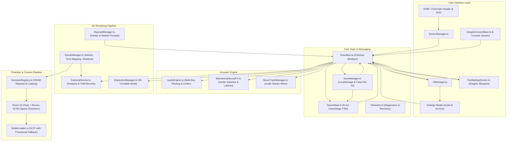

# Technical Architecture Specification: The Vault (Sub-Level 04)

## 1. Architecture Overview & Principles
* **Framework & Tooling:** Vite + TypeScript (`strict: true`), Three.js (`@types/three`), TWEEN.js.
* **Strict Decoupling via Event Mediator:** Zero god objects. The rendering loop, audio engine, state machine, camera director, and UI communicate strictly through a typed publish/subscribe `EventBus`.
* **Single WebGL Context:** A single WebGL renderer manages the room scene and 3D object examination mode via scene swapping and clean camera transitions, preventing WebGL context-limit crashes.
* **Hybrid Asset Pipeline:** Supports loading external `.glb` modular props from Blender (`/assets/models/`) with an automatic, instant fallback to procedural 3D geometry (`ProceduralRoom04.ts`).
* **Diegetic UI Architecture:** All puzzle interfaces, blueprints, and examination surfaces are built as component-scoped diegetic screens with isolated local states, preventing global state pollution.

---

## 2. System Dependency Diagram



---

## 3. Subsystem Breakdown

### 3.1. Core Messaging (`core/EventBus.ts`)
* Lightweight, strongly typed event mediator.
* Standardized event taxonomy:
  * `input:object_clicked`: `{ objectId: string; hitPoint: THREE.Vector3 }`
  * `input:object_hovered`: `{ objectId: string | null; label: string }`
  * `game:stage_transition`: `{ from: GameStage; to: GameStage }`
  * `puzzle:crystal_collected`: `{ crystalId: CrystalId; roomCode: string }`
  * `puzzle:crt_patch_completed`: `{ crystalId: CrystalId }`
  * `scenario:switch_room`: `{ targetRoomId: string; initialHotspot?: string }`
  * `camera:move_to_hotspot`: `{ hotspotId: string }`
  * `ui:modal_opened` / `ui:modal_closed`: `{ modalId: string }`
  * `audio:trigger_fx`: `{ sound: string }`

### 3.2. Finite State Machine (`core/GameState.ts`)
* Manages progression across the 8-Act narrative arc via `GameStage`:
  * `ACT_1_HUB_AWAKEN` -> `ACT_1_HUB_CORRIDOR_OPEN`
  * `ACT_2_SLEEP_WARD` -> `ACT_2_CRYSTAL_1_RECOVERED` -> `ACT_2_PATCH_1_COMPLETE`
  * `ACT_3_HYDROTHERAPY` -> `ACT_3_CRYSTAL_2_RECOVERED` -> `ACT_3_PATCH_2_COMPLETE`
  * `ACT_4_AUDIOLOGY` -> `ACT_4_CRYSTAL_3_RECOVERED` -> `ACT_4_PATCH_3_COMPLETE`
  * `ACT_5_ARCHIVE` -> `ACT_5_CRYSTAL_4_RECOVERED` -> `ACT_5_PATCH_4_COMPLETE`
  * `ACT_6_DIRECTORS_OFFICE` -> `ACT_6_CRYSTAL_5_RECOVERED`
  * `ACT_7_SYNTHESIS_BLACKOUT`
  * `ACT_8_VELVET_LOUNGE` -> `ACT_8_CONCUSSION_TERMINAL`
* Tracks inventory, pending recovered crystals awaiting CRT patch analysis, and Hub environmental rot degradation.

### 3.3. Diegetic Facility Blueprint (`ui/screens/FacilityMapScreen.ts`)
* Architectural 2D SVG schematic of Sub-Level 04 rendered with clinical grid drafting aesthetics.
* **Fog of War Discovery**: Unvisited sectors are rendered with dark crosshatching and classified redaction bars (`█████`); visited chambers reveal detailed room drafting, apparatus icons, and live beacon dot at the player's coordinates.
* **Custom Site Iconography**: Distinct inline SVG symbols for each sector: CRT waveform (Hub), ECG pulse (Sleep Ward), manifold valve (Hydrotherapy), directional horn (Audiology), film spool (Archive), carriage clock escapement (Director), galvanometer bridge spark (Synthesis), and switchboard jacks (Velvet Lounge).
* **Facility Alignment Tracker**: Displays global sector synchronization status (e.g. "1 / 8 SECTORS SYNCHRONIZED") alongside 8 status pips.
* **Non-Linear Transit**: Allows instant bidirectional travel between the Central Hub and any unlocked/visited sector, enforcing pressure seal interlocks (`PRESSURE SEALED // INTERLOCK RESTRICTED`).

### 3.4. Component-Scoped MVC Diegetic Screens (`ui/screens/`)
* Base class `DiegeticScreenBase.ts` provides lifecycle hooks, DOM focus trapping, Escape key stacking, and cleanup.
* Screens isolate internal console logic:
  * `TektronixCrtScreen.ts`: Act I CRT Lissajous harmonic alignment and knife switch interlock.
  * `DispensaryCartScreen.ts`: Act II 2-step sequential machine: Step 1 mechanical shutter (intake code 1-0-4 from clinical charts) unlocking Step 2 internal infusion console (68 BPM peristaltic drip sync + ultraviolet chemical triad `[Nitrous] - [Bromide] - [Valerian]`).
  * `HydraulicManifoldScreen.ts`: Act III siphon manifold volume conservation and drain unseal.
  * `BinauralSynthesizerScreen.ts`: Act IV dual flared horn azimuth rotation and Chladni nodal plate mandala.
  * `MicroficheViewerScreen.ts`: Act V optical magnification and pneumatic dispatch canister routing.
  * `WiretapTapeDeckScreen.ts`: Act VI half-speed tape decoding and desk carriage clock escapement.
  * `GalvanometerGridScreen.ts`: Act VII resistance bridge network and 200 Ohm breaker trip logic.
  * `SwitchboardMirrorScreen.ts`: Act VIII 1950s telephone jack routing matrix and decanter libation gate.

### 3.5. Scenario Lifecycle & VRAM Disposal (`scenarios/ScenarioRegistry.ts`)
* Manages loading and disposal across all 8 room scenario classes.
* Enforces single-transition concurrency locks (`isSwitching = true`).
* Recursively traverses meshes on scenario unmount to deallocate geometries and materials from GPU VRAM:
  ```typescript
  export function disposeHierarchy(object: THREE.Object3D): void {
    object.traverse((child) => {
      if (child instanceof THREE.Mesh) {
        if (child.geometry) child.geometry.dispose();
        if (child.material) {
          if (Array.isArray(child.material)) {
            child.material.forEach((mat) => mat.dispose());
          } else {
            child.material.dispose();
          }
        }
      }
    });
  }
  ```

### 3.6. Multi-Bus Audio Architecture (`audio/AudioEngine.ts` & `MechanicalSoundFX.ts`)
* **Hierarchical Bus Routing**: Master dynamics compressor feeds `masterGain`, which splits into dedicated sub-busses:
  * `sfxGain`: Tactile mechanical switches, relays, knife switches, drawer latches, and phone bells.
  * `ambientGain`: Continuous 45 Hz binaural beat drone, 60/120 Hz ballast hum, room tone, and jazz chords.
* **Independent Gain Controls**: Dedicated sliders in the Settings modal (`#setting-volume`, `#setting-sfx-volume`, `#setting-ambient-volume`) with live percentage readouts (`#volume-val`, `#sfx-val`, `#ambient-val`).
* **Autoplay Compliance**: Gain changes persist to local state without premature `audioCtx.resume()` calls before user gestures.
* **Automatic Tab Suspension**: Suspends `AudioContext` on page visibility blur (`document.hidden`) and restores on focus.

### 3.7. 3D Raycast & Inspection Pipeline (`interaction/`)
* `RaycastManager.ts` resolves child mesh hits to their logical parent interactive group (`prop_*`, `door_*`, `crystal_*`, `exit_*`).
* Enforces dynamic reticle prompt text and exclusive interaction target locks during modal overlays.
* `InspectionManager.ts` runs an isolated 3D turntable canvas with 3-pin mechanical key elevation math.

### 3.8. Persistence & Case Record Architecture (`core/SaveManager.ts`)
* **Schema Version 1 (`SaveGameData`)**: Persists stage, room ID, inventory manifest, collected crystals, patched crystals, pending crystal, calibrated frequency, synthesis flag, visited rooms, and custom settings.
* **Storage Resiliency**: Accesses `localStorage` via safe wrapper `getStorage()` under key `the_vault_save_record`, with automatic fallback to in-memory state in restricted/headless environments.
* **Auto-Save Protocol**: Debounced at 500ms, listening to `game:stage_transition`, `puzzle:crystal_collected`, `puzzle:crt_patch_completed`, `inventory:add`, `ui:inventory_updated`, `scenario:switch_room`, and `settings:updated`.
* **Case Record File Portability**:
  * Export: Serializes intake case file as `subject_104_case_record.json` via Blob download.
  * Import: Validates uploaded JSON against schema version 1 and hydrates `GameState`.
* **Atomic Purge / Reset**: Confirmation modal triggers complete wipe of `localStorage`, teardown of scenario audio, state baseline reset to Act I, and camera return to Sterile Reception.

### 3.9. Automated Verification & Testing Architecture
* **Unit Testing (Vitest)**: 44 unit tests across 8 suites in `src/**/*.spec.ts` testing pure mathematical invariants, save schema serialization, state machine transitions, event mediator routing, and raycast hierarchies.
* **Unified High-Speed Test Architecture (`tests/run_all_fast.js`)**:
  * **Single-Process Chromium Lifecycle**: Launches a single Playwright Chromium instance once for the entire 26-suite regression suite, eliminating recurring browser process spin-up latency and executing the full end-to-end matrix in ~68 seconds.
  * **Context Isolation & GPU WebGL Disposal**: Each test suite is assigned an isolated browser context (`await browser.newContext()`) providing a clean `localStorage`, empty cookies, and pristine DOM state. Calling `await context.close()` after each suite immediately destroys the active Three.js canvas and frees the underlying GPU WebGL context, remaining well beneath Chromium's 16 active WebGL context ceiling.
  * **Dual-Mode Execution Contract**: All 26 test scripts under `tests/` export `runSuite(page, baseUrl)` for the unified runner, while retaining a direct execution guard (`isMain` checking `import.meta.url`) that initializes an ephemeral static HTTP server for standalone debugging.
  * **Ephemeral Port Allocation**: Uses dynamic port binding (`server.listen(0)`) via `tests/helpers/testServer.js` to eliminate `EADDRINUSE` port collisions during concurrent and isolated test runs.
  * **Watchdog Protection**: Each suite is monitored with a 35,000ms async watchdog race to prevent stalled network requests or unhandled promise loops from locking CI pipelines.
* **Granular CLI Runners**: Dedicated scripts (`npm run test:pair1`, `npm run test:pair2`, `npm run test:save`, `npm run test:facility`, etc.) provide targeted scenario verification in under 4 seconds.

