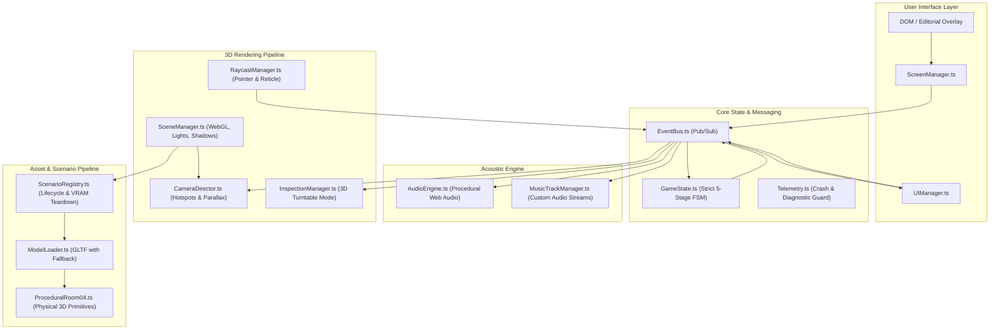

# Technical Architecture Specification: The Vault (Room 04)

## 1. Architecture Overview & Principles
* **Framework & Tooling:** Vite + TypeScript (`strict: true`), Three.js (`@types/three`), TWEEN.js.
* **Core Architectural Principle:** **Strict Decoupling via Event Mediator.** Zero God objects. The rendering loop, audio engine, state machine, camera director, and UI communicate strictly through a typed publish/subscribe `EventBus`.
* **Single WebGL Context:** A single WebGL renderer manages the room scene and 3D object examination mode via scene swapping or layered render passes, preventing WebGL context-limit crashes.
* **Hybrid Asset Pipeline:** Supports loading external `.glb` modular props from Blender (`/assets/models/`) with an automatic, instant fallback to procedural 3D geometry (`ProceduralRoom04.ts`).

---

## 2. System Dependency Diagram



---

## 3. Subsystem Breakdown

### 3.1. Core Messaging (`core/EventBus.ts`)
* Lightweight, strongly typed event mediator.
* Prevents cyclic dependencies and direct module coupling.
* Standardized event taxonomy:
  * `INPUT:OBJECT_CLICKED`: `{ objectId: string; hitPoint: THREE.Vector3 }`
  * `INPUT:OBJECT_HOVERED`: `{ objectId: string | null; label: string }`
  * `GAME:STAGE_TRANSITION`: `{ fromStage: GameStage; toStage: GameStage }`
  * `PUZZLE:ITEM_COLLECTED`: `{ itemId: string }`
  * `PUZZLE:KEY_ALIGNED`: `{ pinExtended: boolean }`
  * `PUZZLE:KEY_INSERTED`: `{}`
  * `PUZZLE:FREQUENCY_CHANGED`: `{ frequency: number; isResonating: boolean }`
  * `PUZZLE:SWITCH_THROWN`: `{}`
  * `CAMERA:MOVE_TO_HOTSPOT`: `{ hotspotId: string }`
  * `INSPECT:OPEN`: `{ targetMesh: THREE.Object3D }`
  * `INSPECT:CLOSE`: `{}`
  * `AUDIO:TRIGGER_FX`: `{ effectId: string }`

### 3.2. Finite State Machine (`core/GameState.ts`)
* Enforces a deterministic, linear progression:
  * `STAGE_0_INIT`: Room sealed, dossier uninspected.
  * `STAGE_1_DOSSIER_UNSEALED`: Crimson envelope opened; frequency clue (528 Hz) revealed.
  * `STAGE_2_BELL_LIFTED`: Bell jar elevated; Brass Key collected into inventory.
  * `STAGE_3_KEY_EXAMINED_AND_ALIGNED`: Key pins deployed via 3D examination mode.
  * `STAGE_4_CONSOLE_REVEALED`: Key inserted; vault faceplate slides open.
  * `STAGE_5_FREQUENCY_LOCKED`: Oscilloscope tuned to 528 Hz; resonance solenoid clicks.
  * `STAGE_6_DEPRESSURIZED_AND_UNLOCKED`: Knife switch thrown; steam hisses; specimen revealed; exit door LED turns green.
* Invalid clicks (e.g., throwing the switch before frequency alignment) are rejected with descriptive context subtitles.

### 3.3. Hybrid Asset Pipeline (`loaders/ModelLoader.ts`)
* Standard load method: `modelLoader.loadProp(propName: string, fallbackBuilder: () => THREE.Group): Promise<THREE.Group>`
* Checks for external GLTF/GLB files in `/assets/models/${propName}.glb`.
* If found: parses scene graph, validates mesh nodes, attaches shadow flags, and returns the group.
* If absent (or if fetch fails due to `file://` CORS restrictions): immediately executes `fallbackBuilder()`, instantiating the procedural 3D primitives from `ProceduralRoom04.ts`.
* Guarantees zero downtime while providing full Blender asset drop compatibility.

### 3.4. PC Camera Ergonomics (`rendering/CameraDirector.ts`)
* **Ambient Mouse Parallax:** Computes mouse offset from screen center; applies a subtle lerped offset ($\pm 0.15$ units) to camera position during idle states.
* **Hotspot Focus Navigation:** Pre-calculated camera positions and look-at targets for:
  * `overview`: Isometric room view.
  * `vault`: Close-up of central titanium apparatus.
  * `telephone`: Close-up of vintage rotary phone.
  * `envelope`: Top-down view of the teak desk and crimson dossier.
  * `door`: View of the sealed blank firedoor.
* **Clamped Hotspot Orbiting:** When focused on a hotspot, OrbitControls is enabled with clamped polar ($15^\circ$ to $65^\circ$) and azimuth angles ($\pm 45^\circ$) to allow examining the object without disorientation.
* **Transition Gating (`isTransitioning`):** Disables raycasting and parallax while camera is tweening to prevent orientation collisions.

### 3.5. 3D Inspection Mode (`interaction/InspectionManager.ts`)
* Uses a secondary Three.js scene (`inspectScene`) rendered to the primary viewport.
* When active, the Brass Key is centered and isolated.
* Player drags with mouse to rotate 360° around any axis.
* Raycasting within the inspection scene detects clicks on the keypin sliding notch, triggering the pin extension animation and dispatching `PUZZLE:KEY_ALIGNED`.
* Exiting returns camera authority cleanly to `CameraDirector`.

### 3.6. VRAM Management & Disposal (`scenarios/ScenarioRegistry.ts`)
* Handles scenario switching without memory leaks.
* Recursively traverses meshes on unmount:
  ```typescript
  export function disposeHierarchy(object: THREE.Object3D): void {
    object.traverse((child) => {
      if (child instanceof THREE.Mesh) {
        if (child.geometry) child.geometry.dispose();
        if (child.material) {
          if (Array.isArray(child.material)) {
            child.material.forEach(disposeMaterial);
          } else {
            disposeMaterial(child.material);
          }
        }
      }
    });
  }
  ```

### 3.7. Audio Architecture (`audio/AudioEngine.ts` & `MusicTrackManager.ts`)
* **Web Audio Autoplay Guard:** `AudioContext` is suspended on initialization and resumed via an explicit pointer listener on the intro screen.
* **Procedural Synthesis:** Synthesizes low 45Hz drone with binaural beating, 60Hz/120Hz ballast buzz, tumbler clicks, 400–700Hz sine sweep, filtered white noise hiss, and clinical two-tone chime.
* **Custom Audio Streams:** `MusicTrackManager` streams external audio files (`/assets/audio/music/`) with automatic volume ramping and crossfading.

### 3.8. Telemetry & Crash Recovery (`core/Telemetry.ts`)
* Global error listener capturing uncaught exceptions, promise rejections, and WebGL context loss.
* Stores diagnostics in a circular memory buffer (100 entries).
* Emits visual recovery indicators in the UI without halting gameplay.
